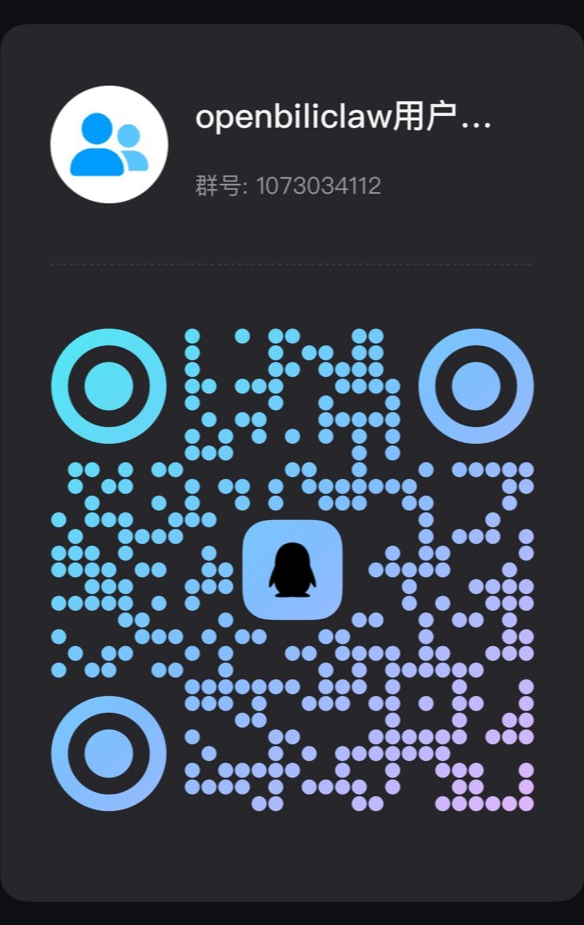
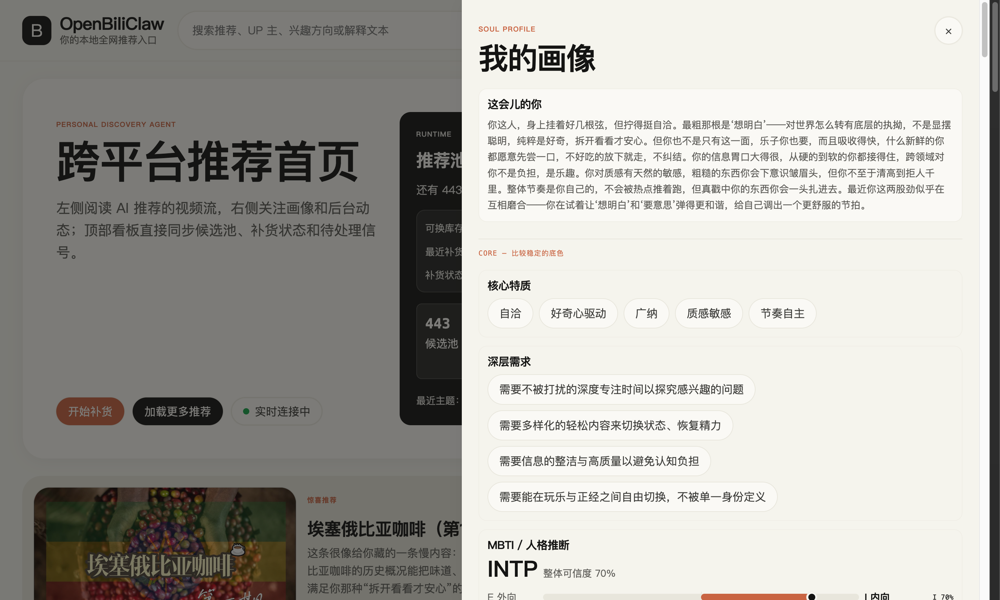
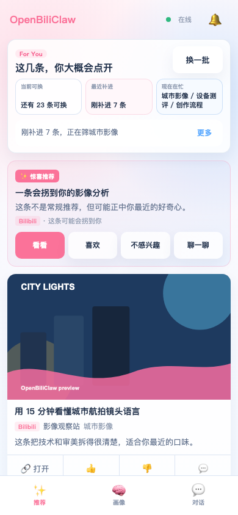
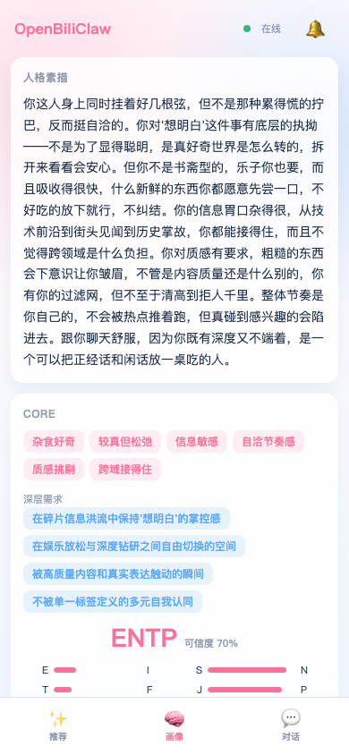
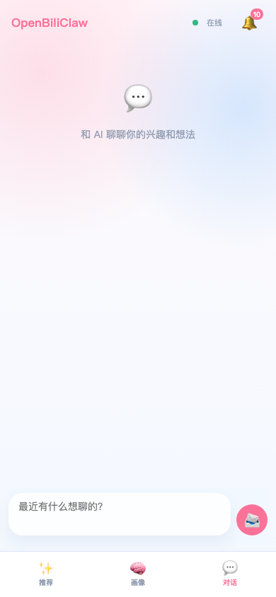

<div align="center">

# 🦀 OpenBiliClaw

**通用个性化内容推荐 Agent——本地运行、跨平台理解你、只为你一个人构建**

*A general-purpose personalized content discovery Agent — runs on your machine, understands only you*

[](https://opensource.org/licenses/MIT)
[](https://www.python.org/downloads/)
[](https://github.com/whiteguo233/OpenBiliClaw/releases/latest)
[](https://github.com/whiteguo233/OpenBiliClaw/releases)
[](https://github.com/whiteguo233/OpenBiliClaw)
[](https://github.com/whiteguo233/OpenBiliClaw/actions/workflows/ci.yml)
[](https://linux.do/t/topic/1978894)
[](https://chromewebstore.google.com/detail/cdfjfkdjjhdaccbldipkjhpibnfbiamg)
[](https://gitee.com/whiteguo233/OpenBiliClaw)
[](https://dshfind.com/zh/plugins)

[项目主页](https://whiteguo233.github.io/OpenBiliClaw/) | [English](README_EN.md) | 中文

国内 AtomGit 源码镜像：[OpenBiliClaw](https://atomgit.com/whiteguo233/OpenBiliClaw)

</div>

<p align="center">
  <picture>
    <source media="(prefers-color-scheme: dark)" srcset="https://whiteguo233.github.io/OpenBiliClaw/images/siliconflow-logo-dark.png">
    
  </picture>
  <br>
  <sub>模型算力支持：感谢 <a href="https://www.siliconflow.cn">硅基流动（SiliconFlow）</a> 提供免费模型额度与推理支持 · <a href="docs/partners.md">合作说明</a></sub>
</p>

> ### 🆕 重要更新：OpenBiliClaw 现在可以装进 DeepSeek Harness
>
> 新增 **DSH 客户端插件** —— 把 OpenBiliClaw 装进 [DeepSeek Harness](https://github.com/deepseek-ai/DeepSeek-Harness)：DSH 界面常驻第四栏（推荐 / 内容库 / 对话 / 画像 / 设置），并注册 22 个 Agent Bridge 工具，让 DSH 里的 Agent 也能读推荐、答探测、闭环学习——边用 DSH 干活，边刷跨平台个性化内容。→ [`github.com/whiteguo233/dsh-openbiliclaw`](https://github.com/whiteguo233/dsh-openbiliclaw)
>
> 📱 想要原生 App？Flutter 移动端客户端（Android / iOS / Web / 桌面）在独立仓库 [`OpenBiliClaw-mobile`](https://github.com/whiteguo233/OpenBiliClaw-mobile)：推荐、对话、画像、收藏 / 稍后再看 / 30 天历史一应俱全，连接同一本地后端。

> 🇨🇳 **国内源**：[Gitee](https://gitee.com/whiteguo233/openbiliclaw/tree/main) 与 [AtomGit](https://atomgit.com/whiteguo233/OpenBiliClaw) 提供源码镜像；最新版安装包与插件请从 [GitHub Release](https://github.com/whiteguo233/OpenBiliClaw/releases/latest) 获取（[123 云盘](https://4001474255.share.123pan.cn/123pan/IxbZMh-90KO3)目前仅保留 v0.3.213 历史文件）。

## 💬 用户交流群

<div align="center">

<table>
  <tr>
    <td align="center" valign="middle" width="420">
      <br/>
      <b>QQ 用户群</b><br/>
      <sub>群号 <code>1073034112</code> · 扫码加入交流</sub>
    </td>
    <td align="center" valign="middle" width="420">
      <a href="https://discord.gg/PU6Xgch8yg"></a><br/>
      <b>Discord 社区</b><br/>
      <sub>扫码或<a href="https://discord.gg/PU6Xgch8yg">点击加入</a>，链接长期有效</sub>
    </td>
  </tr>
</table>

</div>

## 10 秒看懂 OpenBiliClaw

一个纯本地、私有、开源的自进化跨平台内容发现 Agent。它从你的跨平台行为、反馈和对话中持续深化五层心理画像，带着对你的理解主动去 **B 站、小红书、抖音、YouTube、TikTok、X、知乎、Reddit、Linux.do、Bangumi、V2EX、微博、GitHub、Instagram** 以及你用一句话订阅的**任意网站和 RSS** 里寻找好内容。

| 跨平台 | 零门槛试用 | 本地优先 | 越用越懂你 |
|---|---|---|---|
| 14 个内置平台 + 自定义网站 / RSS，打破推荐孤岛 | 预置免费大模型与向量服务，无需先配 API Key 也能跑通 | 画像、历史与候选池默认留在你本机的 SQLite | 喜欢、踩雷、对话调教与兴趣探针实时重塑后续推荐 |

<p align="center">
  <a href="https://chromewebstore.google.com/detail/cdfjfkdjjhdaccbldipkjhpibnfbiamg"><b>安装浏览器插件</b></a>
  ·
  <a href="https://github.com/whiteguo233/OpenBiliClaw/releases/latest"><b>下载桌面安装包</b></a>
  ·
  <a href="#快速开始"><b>4 步快速开始</b></a>
  ·
  <a href="https://github.com/whiteguo233/OpenBiliClaw"><b>⭐ Star 支持项目</b></a>
</p>

<p align="center">
  
</p>

## 快速开始

普通用户只需四步即可跑通；Firefox / Safari、Docker、Shell 脚本及源码手动部署等路径见 [安装与部署详情](#安装与部署详情)。

1. **装插件** —— 从 [Chrome 应用商店](https://chromewebstore.google.com/detail/cdfjfkdjjhdaccbldipkjhpibnfbiamg) 一键安装（自动更新，支持 Chrome / Edge / Brave / Arc），或从 [Latest Release](https://github.com/whiteguo233/OpenBiliClaw/releases/latest) 下载 zip / Firefox / Safari 扩展包获取最新功能。
2. **装后端（二选一）**
   - **最省事 · 桌面安装包**：到 [Latest Release](https://github.com/whiteguo233/OpenBiliClaw/releases/latest) 下载 macOS `.dmg`（Apple Silicon / Intel）或 Windows `Setup.exe`，开箱即用、常驻菜单栏/托盘，内置免费模型与本地 BGE-M3 支持。
   - **可定制 · 让 AI 编程助手部署**：把下面整句粘给 Claude Code / Codex CLI / Cursor / Windsurf：
     ```text
     请按照 https://raw.githubusercontent.com/whiteguo233/OpenBiliClaw/main/docs/agent-install.md 的说明帮我部署 OpenBiliClaw 后端(务必用 Bash 的 curl 下载这个文档,不要用 WebFetch — 会丢关键指令)
     ```
3. **连接来源并初始化** —— 在装了插件的浏览器登录 [B 站](https://www.bilibili.com)（默认初始化来源），或按需开启小红书 / 抖音 / YouTube / X / 知乎 / Reddit / Linux.do / Bangumi / V2EX / 微博 / GitHub / TikTok / Instagram，在引导页点一下完成首次画像生成（也可以在「聊一聊」直接发网址订阅 RSS 或动态网站）。
4. **打开你的推荐入口**
   - **桌面大屏**：访问 `http://127.0.0.1:8420/web`（或直接打开 `http://127.0.0.1:8420/`）
   - **浏览器侧边栏**：在任意支持站点点击 OpenBiliClaw 扩展图标
   - **手机端**：用插件顶部二维码打开移动端 Web `http://<局域网 IP>:8420/m/`（可添加到主屏幕），或安装原生 [Flutter 客户端](https://github.com/whiteguo233/OpenBiliClaw-mobile)（Android / iOS 支持内嵌 [Tailnet](docs/modules/tailnet.md) 跨网络直连回家）

## 📸 功能预览

一套本地后端，五个协同入口：**浏览器插件**负责平台交互、登录会话与只读任务；**桌面 Web（`/web`）**提供大屏推荐与实时看板；**移动 Web（`/m`）**适配手机触屏；独立仓库的 **Flutter 原生 App**（[OpenBiliClaw-mobile](https://github.com/whiteguo233/OpenBiliClaw-mobile)）覆盖 Android / iOS / 桌面；**DSH 客户端插件**（[dsh-openbiliclaw](https://github.com/whiteguo233/dsh-openbiliclaw)）把推荐流和 22 个 Agent 工具带进 DeepSeek Harness。

<div align="center">

<table>
  <tr>
    <td align="center" width="50%">
      <br/>
      <b>桌面推荐首页</b><br/>
      <sub>惊喜推荐 Hero · 为你推荐网格 · 朋友式推荐理由</sub>
    </td>
    <td align="center" width="50%">
      <br/>
      <b>灵魂画像 + 实时动态</b><br/>
      <sub>人格素描 · 核心特质 · 深层需求 · MBTI 推断 · 后台认知动态</sub>
    </td>
  </tr>
</table>

<table>
  <tr>
    <td align="center" width="25%">
      <br/>
      <b>手机推荐页</b><br/>
      <sub>惊喜推荐 + 池子状态 · 朋友式推荐理由</sub>
    </td>
    <td align="center" width="25%">
      <br/>
      <b>智能反馈闭环</b><br/>
      <sub>喜欢 / 稍后 / 收藏 / 少来点 / 说原因</sub>
    </td>
    <td align="center" width="25%">
      <br/>
      <b>自然语言画像</b><br/>
      <sub>看懂“为什么喜欢”而不是标签堆砌</sub>
    </td>
    <td align="center" width="25%">
      <br/>
      <b>对话调教 & 加源</b><br/>
      <sub>聊天改口味，发个网址就能订阅</sub>
    </td>
  </tr>
</table>

</div>

<details>
<summary>更多界面截图（特质 · 价值 · 认知风格 · 移动端画像与对话）</summary>

<div align="center">

<table>
  <tr>
    <td align="center" width="33%">
      <br/>
      <b>结构化特质</b><br/>
      <sub>MBTI · 核心特质 · 深层需求</sub>
    </td>
    <td align="center" width="33%">
      <br/>
      <b>价值偏好与猜测兴趣</b><br/>
      <sub>内在驱动力 · 探索兴趣方向</sub>
    </td>
    <td align="center" width="33%">
      <br/>
      <b>认知风格</b><br/>
      <sub>信息处理偏好 · 内容口味</sub>
    </td>
  </tr>
  <tr>
    <td align="center" width="33%">
      <br/>
      <b>手机端画像</b><br/>
      <sub>随时查看和手动校准画像</sub>
    </td>
    <td align="center" width="33%">
      <br/>
      <b>手机端对话</b><br/>
      <sub>与桌面、插件共享主对话历史</sub>
    </td>
    <td align="center" width="33%">
      <br/>
      <b>桌面推荐卡片网格</b><br/>
      <sub>大屏瀑布式浏览与快捷反馈</sub>
    </td>
  </tr>
</table>

</div>

</details>

## 最近更新

📌 最新版本：**v0.3.239（2026-11-16）**

- **Windows 安装可选路径**。交互式安装和升级都显示「选择目标位置」，升级默认填原目录。
- **免费模型画像更完整**。初始画像保留核心与价值层，未知 MBTI 标为待确认。
- **对话界面更紧凑**。桌面与插件把非聊天控件收进折叠条，小窗聊天可视区域明显变大。
- **插件设置页排版修复**。设置页空白段与窄宽度截断消除，320px 下仍能正常保存。

完整变更详见 [docs/changelog.md](docs/changelog.md)。

## 为什么需要 OpenBiliClaw？

> 名字起源于 B 站（`Bili` = Bilibili，`Claw` = 爪子），项目最早只支持 B 站。从 v0.3.0 起已演进为通用跨平台 Agent，覆盖 B 站、小红书、抖音、YouTube、TikTok、X、知乎、Reddit、Linux.do、Bangumi、V2EX、微博、GitHub、Instagram 与自定义网站 / RSS，持续扩展更多来源。

传统推荐系统本质上是站在流量和广告指标一侧的**中间商**——它在十几个商业目标之间权衡排序，用户满意只是留存和变现的副产品；更麻烦的是每个平台彼此割裂，你在 B 站看机械键盘、在小红书研究咖啡器具、在 GitHub 收藏 Agent 项目，没有任何平台替你把这些线索拼成完整的“你”。

**OpenBiliClaw 把顺序反过来**——先理解你这个人，再带着理解去全网主动找内容：

- 🧠 **先懂你，再找内容**：通过行为分析沉淀五层灵魂画像（事件 → 偏好 → 觉察 → 洞察 → 灵魂），推断 MBTI、认知风格与深层心理需求。
- 🔮 **主动探索，打破信息茧房**：用心理学桥接主动猜测你从未点过但可能着迷的领域（比如从机械表桥接到建筑美学），猜对升级为正式兴趣，猜错安静退出。
- 🔒 **100% 本地，100% 你的**：行为、画像、候选池与对话历史留在本地 SQLite；可直接使用预置免费模型、切换自有 API Key，或实验性复用本机 Codex CLI OAuth。没有云端账号体系，你怎么调教，它就怎么长。

> | 对比维度 | 各平台官方推荐 | 关键词过滤插件 | OpenBiliClaw |
> |---|---|---|---|
> | 推荐逻辑 | 协同过滤 / 商业权重 | 规则 / 标签匹配 | 心理画像 + 五层记忆 + 多轮对话 |
> | 内容来源 | 单一平台 | 单一平台 | 14 类平台 + 任意网站 / RSS 跨平台混排 |
> | 信息茧房 | 越推越窄 | 不解决 | 兴趣探针主动破茧 |
> | 数据归属 | 平台所有 | 通常云端 | 100% 本地 SQLite |
> | 推荐解释 | “猜你喜欢” | 无 | 像朋友一样说清为什么适合你 |
> | 可定制性 | 不可控 | 低 | 换模型 / 改画像 / 加网站 / 接 Agent |

## ✨ 核心特性

### 理解与推荐
- 🧠 **五层灵魂画像** — 事件 → 偏好 → 觉察 → 洞察 → 灵魂，沉淀人格素描、MBTI、认知风格与深层需求（[模块文档](docs/modules/soul.md)）。
- 🔮 **兴趣探针 & 避雷探针** — 主动提出潜在兴趣假设与内容雷区边界，支持四态确认；只有确认后才写入长期偏好与过滤规则。
- 💬 **有温度的推荐理由 & 惊喜队列** — 每条推荐用朋友口吻解释“为什么戳中你”，高分精选单独进入顶部惊喜推荐。
- 🎯 **智能多样性 & 极速去重换批** — 主题配额 + 跨平台混排 + 小源保护，约 0.6s 极速换一批，默认排除已刷/已看/已不喜欢内容。

### 全网内容源与自定义网站
- 🌐 **14 大内置平台** — 一套理解打通视频、短图文、长问答与技术社区，打破平台间的信息孤岛。
- 🕸️ **聊天一句话加网站 / RSS** — 在「聊一聊」粘贴任何 RSS/Atom/JSON Feed 或网页 URL 与想看的内容，试跑确认后即可定时抓取；macOS 原生集成托管 **Ego Lite**，需要登录的网站可在应用内人工接管页安全登录（[详情](docs/modules/web.md)）。

### 多端入口与 Agent 生态
- 🧩 **全主流浏览器插件** — 支持 Chrome / Edge / Brave / Arc / Firefox / Safari，提供侧边栏推荐、行为采集与同源只读任务。
- 🖥️ **桌面 / 移动 Web & Flutter 原生 App** — 本机自带 `/web` 桌面端与 `/m/` 移动 PWA，配合独立仓库 [OpenBiliClaw-mobile](https://github.com/whiteguo233/OpenBiliClaw-mobile) 提供原生移动/桌面体验。
- 🛜 **应用内 Tailnet 远程回家** — 电脑端与 Android / iOS 原生 App 各自内嵌 `tsnet`，无需系统安装 Tailscale、无需公网 Funnel 即可跨网安全连回家（[详情](docs/modules/tailnet.md)）。
- 🤖 **OpenClaw / Hermes / DSH Agent 联动** — 内置 `agent-bridge/v2` 与 Skill，支持 Agent 主动推送惊喜、追问兴趣、读取画像和反馈闭环（[接入指南](docs/openclaw-quickstart.md)）。

### 私有、免费与可控
- 🆓 **预置免费模型 & 本地向量** — 开箱内置硅基流动免费 LLM（Qwen3-8B / Qwen3.5-4B）与云端 BGE-M3，也支持 Ollama 本地 `bge-m3` 或任意 OpenAI / Anthropic / Gemini / DeepSeek 实例。
- ⭐ **本地优先收藏 / 稍后看 & 30 天历史** — 收藏与稍后看先落本地 SQLite（自动同步默认关闭，开启后可精确写回 B 站等 7 个平台），近 30 天点开过、出现未点与最近移除记录三端统一可查可恢复。
- 📦 **跨机器一键迁移 & 可选多模态** — 桌面端支持 `.obcbackup` 一键导出/导入（含校验与回滚保护）；支持封面、关键帧与弹幕视觉语义加权（[详情](docs/modules/recommendation.md)）。

## 🌐 支持的内容来源

| 来源 | 发现方式 | 接入与认证边界 | 更多 |
|---|---|---|---|
| **B 站** | 搜索 · 趋势 · 关联链 · 跨域探索 | 后端 WBI 签名 API 直连；需登录同浏览器以拉取历史/收藏/关注 | [bilibili.md](docs/modules/bilibili.md) |
| **小红书** | 被动收集 · 搜索 · 创作者 · 初始化 | 已登录浏览器插件读取页面，零后端爬取 | [discovery.md](docs/modules/discovery.md) |
| **抖音** | 初始化 · 搜索 · 热点 · 推荐流 | 插件首页 DOM 触发与响应收集，复用正式发现调度 | [discovery.md](docs/modules/discovery.md) |
| **YouTube** | 初始化 · Takeout 离线 · 搜索 / 热门 / 频道 | 插件读取观看历史/订阅/点赞，后端直连日常补池 | [youtube.md](docs/modules/youtube.md) |
| **TikTok** | 推荐流 · 话题 · 创作者 · 登录后搜索 | 默认关闭；访客发现免登录，搜索同步扩展凭据，需海外网络 | [tiktok.md](docs/modules/tiktok.md) |
| **X（Twitter）** | 初始化 · 搜索 · For-You · 关注作者 | 后端只读会话（`twitter-cli`）复用插件同步的 Cookie，纯文本卡 | [source-auth.md](docs/modules/source-auth.md) |
| **知乎** | 初始化 · 搜索 · 热榜 · 推荐 · 作者 · 相关 | 已登录浏览器插件只读任务，输出文字卡片 | [zhihu.md](docs/modules/zhihu.md) |
| **Reddit** | 初始化 · 搜索 · 热门 · Subreddit · 相关 | 默认 `rdt-cli` 发现（插件同步会话），异常时回退扩展任务 | [source-auth.md](docs/modules/source-auth.md) |
| **Linux.do** | 书签/点赞/阅读初始化 · 5 路发现 | 公开免登录；个人信号在隔离 tab 内同源 GET，`_t` 不出浏览器 | [linuxdo.md](docs/modules/linuxdo.md) |
| **Bangumi** | 公开收藏初始化 · 搜索 · 排名 · 按日浏览 | 官方匿名只读 v0 API；可填公开用户名或个人令牌增强 | [bangumi.md](docs/modules/bangumi.md) |
| **V2EX** | 搜索 · Node · Tab · 热门 · 最新 | 匿名官方 API/Feed；已登录扩展/可选 PAT 可读本人收藏与回复 | [v2ex.md](docs/modules/v2ex.md) |
| **微博** | 初始化 · 搜索 · 热榜 · 创作者 | 公开 discovery 后端匿名完成；个人初始化走同源扩展任务 | [weibo.md](docs/modules/weibo.md) |
| **GitHub** | Star 初始化 · 搜索 · 排名 · 最新 | 官方 REST API 匿名只读公开仓库；可选 PAT 提额，不碰插件 | [github.md](docs/modules/github.md) |
| **Instagram** | 话题/创作者发现 · 点赞/收藏/关注初始化 | 默认关闭；同一浏览器登录后有界导入，需海外网络（[实测](docs/platform-source-acceptance.instagram.md)） | [instagram.md](docs/modules/instagram.md) |
| **自定义网站 / RSS** | 聊天建源 · 试跑样例 · 接管登录 · 定时采集 | Feed 走匿名安全 HTTP；动态网站在 macOS 走托管 Ego Lite | [web.md](docs/modules/web.md) |

> **数据边界**：不保存平台密码，不绕过登录；账号周期回拉默认关闭（手动点「开始初始化」或显式开启时才拉取）；开箱默认只启用 B 站，其余来源按需在设置页勾选开启。完整平台验收与技术契约见 [docs/modules/source-auth.md](docs/modules/source-auth.md)。

## 🤖 接入 OpenClaw / Hermes / WorkBuddy Agent

仓库内置 [workspace skill](skills/openbiliclaw-adapter/SKILL.md) 与版本化 Agent Bridge（`agent-bridge/v2`）。把下面这句粘给 OpenClaw、Claude Code、Codex CLI 或 Cursor，宿主即可自动接管本机 OpenBiliClaw：

```text
请按照 https://raw.githubusercontent.com/whiteguo233/OpenBiliClaw/main/docs/openclaw-quickstart.md 的说明帮我把当前仓库接入 Agent Bridge（目标宿主是 OpenClaw；务必用 Bash 的 curl 下载这个文档，不要用 WebFetch — 会丢关键指令）
```

<details>
<summary>接入后典型使用场景（主动惊喜推送 · 主动追问兴趣 · 按需点播）</summary>

1. **系统主动推惊喜**：后台发现高分内容时通过 WebSocket `delight.candidate` 推给宿主，宿主转述后把你的反馈幂等写回学习闭环。
2. **系统主动追问兴趣 / 避雷**：收到 `interest.probe` 后向你求证，并可继续多轮苏格拉底式对话，确认后直接更新灵魂画像。
3. **随时按需点播**：直接对宿主说“给我推三条今天值得看的 B 站内容”，内部调用 `recommend --limit 3` 整理回复，全程数据不离本机。

完整能力契约与命令见 [OpenClaw 快速接入](docs/openclaw-quickstart.md) 与 [Agent Bridge 能力说明](docs/agent-integration.md)。

</details>

## 安装与部署详情

### 1. 安装浏览器插件

插件基于 Manifest V3，支持 **Chrome / Edge / Brave / Arc / Vivaldi / Opera**，同时提供 **Firefox（140+）** 与 **Safari（macOS）** 构建。

- **获取最新版本（推荐）**：打开 [OpenBiliClaw Latest Release](https://github.com/whiteguo233/OpenBiliClaw/releases/latest) 的 `openbiliclaw-v*` 聚合页：
  - Chrome / Edge / Brave：下载 `openbiliclaw-extension-v*.zip`，在 `chrome://extensions/` 开启「开发者模式」后直接拖入安装。
  - Firefox：优先直接安装签名版 `openbiliclaw-extension-v*-firefox.xpi`；若仅提供 `*-firefox.zip`，可在 `about:debugging` 临时加载。
  - Safari（macOS）：下载 `openbiliclaw-extension-v*-safari.dmg`，运行 App 一次后在 Safari 设置 → 扩展勾选启用（详看 [Safari 构建文档](docs/safari-extension-build.md)）。
- **省事自动更新**：从 [Chrome 应用商店](https://chromewebstore.google.com/detail/cdfjfkdjjhdaccbldipkjhpibnfbiamg) 一键安装（商店审核原因，版本通常比 Release 晚几天）。

<details>
<summary>Firefox 源码构建与临时调试说明</summary>

```bash
git clone https://github.com/whiteguo233/OpenBiliClaw.git
cd OpenBiliClaw/extension
npm install
npm run build:firefox          # 输出 dist-firefox/
npm run package:firefox        # 打包未签名 zip
```

在 `about:debugging#/runtime/this-firefox` 点击「Load Temporary Add-on…」，选中解压或 `extension/dist-firefox/` 下的 `manifest.json`。注意临时加载重启浏览器后会失效，日常使用请优先选择已签名 `.xpi` 或商店上架版本。

</details>

### 2. 部署后端

#### 方式 A：下载桌面安装包（最省事）

从 [Latest Release](https://github.com/whiteguo233/OpenBiliClaw/releases/latest) 的 `openbiliclaw-v*` 聚合页下载对应系统包（聚合页按同版本展示 `backend-v*` / `extension-v*` / `desktop-v*`，缺失渠道不会回填旧版本）：

- **macOS**：Apple Silicon 下载 `OpenBiliClaw-macos-v*-arm64.dmg`，Intel 下载 `OpenBiliClaw-macos-v*-x64.dmg`（如提供）。退出旧版后打开 DMG，将应用拖入「应用程序」或其他可写目录并启动（升级时替换原目录旧应用）。
  > **macOS 签名与公证**：CI 强制执行 Developer ID 签名与 Apple 公证，无需手动执行解除隔离命令。详见 [打包与签名说明](docs/modules/packaging.md)。
- **Windows**：下载 `OpenBiliClaw-windows-*-Setup.exe` 双击安装，支持自定义「选择目标位置」（升级默认沿用原目录）。如果出现 SmartScreen 提示，点「更多信息 → 仍要运行」。

Apple Silicon 与 Windows 均提供**精简版**和 **`-with-embedding` 版**（预置本地 BGE-M3，约 1.1GB）；macOS 兼容 10.15+（可选内嵌 Tailnet helper 需 macOS 12+）。启动后常驻菜单栏/托盘，数据统一存于 `~/OpenBiliClaw`（Windows 为 `%USERPROFILE%\OpenBiliClaw`）。

#### 方式 B：AI 一句话部署（可改源码 / 深度定制）

```text
请按照 https://raw.githubusercontent.com/whiteguo233/OpenBiliClaw/main/docs/agent-install.md 的说明帮我部署 OpenBiliClaw 后端(务必用 Bash 的 curl 下载这个文档,不要用 WebFetch — 会丢关键指令)
```

<details>
<summary>备用部署：Shell / PowerShell 一键脚本</summary>

**macOS / Linux / WSL2**：
```bash
curl -fsSL https://raw.githubusercontent.com/whiteguo233/OpenBiliClaw/main/scripts/install.sh | bash
```

**Windows 原生（PowerShell，无需 Docker / WSL2）**：
```powershell
[Net.ServicePointManager]::SecurityProtocol = [Net.ServicePointManager]::SecurityProtocol -bor [Net.SecurityProtocolType]::Tls12; iwr https://raw.githubusercontent.com/whiteguo233/OpenBiliClaw/main/scripts/install.ps1 -UseBasicParsing | iex
```

脚本依赖 `git` 与 Python 3.11+，会在终端向导中收集模型、embedding 与平台开启选项，校验 LLM 与 embedding 服务可用后自动运行 init（macOS 同时准备私有 Ego Lite）。

</details>

<details>
<summary>备用部署：Docker Compose（自带 Ollama sidecar）</summary>

```bash
mkdir -p ~/openbiliclaw && cd ~/openbiliclaw
curl -fsSLO https://raw.githubusercontent.com/whiteguo233/OpenBiliClaw/main/docker-compose.prebuilt.yml
docker compose -f docker-compose.prebuilt.yml up -d
docker exec -it openbiliclaw-backend openbiliclaw set-password
docker restart openbiliclaw-backend
# 打开 http://127.0.0.1:8420/web/ 登录后进入 /setup/
```

公网域名 HTTPS（Caddy 自动证书）及容器详细排障见 [Docker 部署指南](docs/docker-deployment.md) 与 [HTTPS 部署指南](docs/https-deployment.md)。

</details>

<details>
<summary>进阶配置：本地 Ollama Embedding · 远程访问 / Tailnet · 手动源码与 CLI</summary>

- **本地 Ollama Embedding**：安装 [Ollama](https://ollama.com/download) 后运行 `uv run openbiliclaw setup-embedding`，向导会自动拉取 `bge-m3`（CPU 可跑）。
- **局域网 / 远程访问安全**：默认 `[api.auth].enabled=false` 仅允许本机可信调用；手机、局域网或反向代理连接前，请在本机设置启用应用密码（或运行 `openbiliclaw set-password`），远程插件需通过 `openbiliclaw ext-key generate` / `enable` 配对（[访问认证](docs/modules/api-auth.md) · [手机连接指南](docs/mobile-connection.md)）。
- **应用内 Tailnet 跨网直连**：桌面安装包已内置 helper，本机设置页「通用 → 应用内 Tailnet 远程访问」开启并重启即可配合 Android / iOS 原生 App 直连；源码安装需先准备 Go 1.26.6 并执行 `openbiliclaw tailnet build-helper` 与 `openbiliclaw tailnet enable`（[Tailnet 文档](docs/modules/tailnet.md)）。
- **手动源码安装与常用 CLI**：
  ```bash
  git clone https://github.com/whiteguo233/OpenBiliClaw.git && cd OpenBiliClaw
  uv sync && cp config.example.toml config.toml
  openbiliclaw init        # 初始化画像与首轮发现
  openbiliclaw start       # 启动后端（Web 位于 http://127.0.0.1:8420/web）
  openbiliclaw discover    # 手动发现内容
  openbiliclaw recommend   # 终端查看推荐
  openbiliclaw profile     # 终端查看画像
  ```
  详细指令与调试排障见 [CLI 文档](docs/modules/cli.md)、[配置文档](docs/modules/config.md) 与 [Agent 部署排障](docs/agent-deployment.md)。

</details>

## 🏛️ 架构概览

```text
┌───────────────────────────────────────────────────────────────────────────────┐
│                                  使用入口层                                   │
│  浏览器插件 (Chrome/Edge/Firefox/Safari) · 桌面 Web (/web) · 移动 Web (/m)    │
│  Flutter 原生端 (OpenBiliClaw-mobile) · DSH 插件 · Agent 宿主 (OpenClaw 等)   │
└───────────────────────────────────────┬───────────────────────────────────────┘
                                        │ 本地 HTTP / WebSocket (127.0.0.1 / LAN)
                                        │ 可选：应用内 Tailnet · Caddy HTTPS · TLS Proxy
┌───────────────────────────────────────▼───────────────────────────────────────┐
│                        FastAPI 本地后端 & Runtime 调度                        │
│   并发闸门 · 后台补池 · Presence 心跳 · 跨进程预算 · 应用级配置热重载/迁移    │
├───────────────────┬───────────────────┬───────────────────┬───────────────────┤
│    Soul Engine    │   Memory System   │ Discovery Engine  │  Recommendation   │
│ 五层心理画像演化  │   多层网状记忆    │ 15 类来源统一准入 │ 混排·多样性·解释  │
├───────────────────┴───────────────────┴───────────────────┴───────────────────┤
│  LLM & Embedding 路由（预置硅基流动免费模型 · Ollama · 多渠道有序故障切换链） │
│  LLM 成本层：价格目录 · 每日 CNY 上限 + 共享预留 · 峰谷窗口 · 同模型选价        │
│  本地 SQLite 存储（行为 · 画像 · 候选池 · 已看账本 · 对话 · 收藏/历史）       │
└───────────────────────────────────────────────────────────────────────────────┘
```

> 为了保持 README 精简，完整的子系统并发闸门、Jev 完整评估、推荐导演、Ego 托管以及各平台任务状态机图已沉淀到单独文档：
> - [架构总览 ASCII 图](docs/architecture-overview.md)（[English](docs/architecture-overview.en.md)）
> - [完整系统架构设计](docs/architecture.md) · [可视化交互架构图](docs/index.md#可视化架构图)
> - 核心模块：[Soul 灵魂引擎](docs/modules/soul.md) · [Discovery 发现引擎](docs/modules/discovery.md) · [Recommendation 推荐引擎](docs/modules/recommendation.md)

<details>
<summary>项目结构与技术栈概览</summary>

```text
OpenBiliClaw/
├── src/openbiliclaw/          # Python 后端核心
│   ├── agent/                 # Agent 编排、对话 Loop 与 Skill 系统
│   ├── soul/                  # 五层灵魂画像、MBTI、兴趣/避雷探针与结算
│   ├── memory/                # 多层网状记忆系统
│   ├── discovery/             # 多源发现策略、待评估池、Jev/LLM 评估与多样性选择
│   ├── recommendation/        # 推荐排序、惊喜队列、朋友式表达与导演模式
│   ├── sources/               # 15 类内容源适配、任务桥与 Ego Lite / HTTP 工作流
│   ├── api/                   # 本地 FastAPI 服务、鉴权、迁移与独立推荐/图片子进程
│   ├── runtime/               # 后台刷新、Presence 追踪、自启动与自动更新
│   ├── llm/                   # 多实例 Provider 路由、提示词缓存与结构化容错
│   ├── i18n/                  # 简/繁/英三语目录与输出语言契约
│   ├── web/                   # 内置桌面端 (/web)、移动端 (/m) 与引导初始化 (/setup)
│   └── storage/               # SQLite 持久化与向后兼容迁移
├── extension/                 # Chrome / Edge / Firefox / Safari (Manifest V3) 插件
├── packaging/                 # macOS DMG / Windows 安装器与系统托盘入口
├── skills/                    # 内置 Workspace Skill（OpenClaw / Agent Bridge）
├── docs/                      # 模块文档、架构图、验收台账与项目主页
└── tests/                     # 10,000+ 自动化单元测试与契约回归
```

| 层级 | 核心技术 |
|---|---|
| 后端与存储 | Python 3.11+ · FastAPI · APScheduler · SQLite + Embedding 向量索引 |
| 浏览器插件 | TypeScript · Manifest V3（`sidePanel` / Firefox `sidebar_action` / Safari Web Extension） |
| 模型与向量 | 多实例有序故障切换链（预置硅基流动 Qwen3 / BGE-M3 · DeepSeek · OpenAI · Claude · Gemini · OpenRouter · Ollama · 任意 OpenAI 协议服务） |
| 网络与部署 | 桌面打包（PyInstaller + 公证 DMG / Inno Setup）· Docker Compose · 应用内 `tsnet` · Caddy / 内置 TLS Proxy |

</details>

## 📖 文档与生态导航

- [文档导航中心](docs/index.md) — 一站式用户与开发者文档入口
- [常见问题 FAQ](docs/faq.md) — 安装 / 连接 / 更新 / 迁移高频问题速查
- [架构设计](docs/architecture.md) · [规格说明](docs/spec.md) · [记忆系统](docs/memory-design.md)
- [CLI 参考](docs/modules/cli.md) · [配置参考](docs/modules/config.md) · [更新日志](docs/changelog.md)
- [Flutter 移动客户端](https://github.com/whiteguo233/OpenBiliClaw-mobile) · [DSH 客户端插件](https://github.com/whiteguo233/dsh-openbiliclaw)

## 🗺️ 后续规划

- **更多高质量内容源** — 持续按统一契约与真实验收门禁接入更多垂直社区与资讯站点。
- **更深的跨平台兴趣融合** — 将视频、长文、短图文与开源项目的信号更紧密地编织为统一画像与跨源关联推荐。
- **开放插件生态** — 完善自定义 SourceAdapter、共享发现策略与社区扩展能力。

## 🤝 贡献与致谢

欢迎贡献！请先查看 [开发指南](docs/contributing.md)。

感谢所有贡献者的持续打磨：[@addtion99](https://github.com/addtion99)（[#8](https://github.com/whiteguo233/OpenBiliClaw/pull/8)）、[@jiaobenhaimo](https://github.com/jiaobenhaimo)（[#53](https://github.com/whiteguo233/OpenBiliClaw/pull/53)）、[@tangle111-design](https://github.com/tangle111-design)（[#69](https://github.com/whiteguo233/OpenBiliClaw/pull/69)）、[@DongLanQwQ0](https://github.com/DongLanQwQ0)（[#102](https://github.com/whiteguo233/OpenBiliClaw/pull/102), [#110](https://github.com/whiteguo233/OpenBiliClaw/pull/110)）、[@wuwafly3](https://github.com/wuwafly3)（[#100](https://github.com/whiteguo233/OpenBiliClaw/pull/100), [#135](https://github.com/whiteguo233/OpenBiliClaw/pull/135)）、[@LHMQ878](https://github.com/LHMQ878)（[#182](https://github.com/whiteguo233/OpenBiliClaw/pull/182)）、[@Patrick5D](https://github.com/Patrick5D)（[#179](https://github.com/whiteguo233/OpenBiliClaw/pull/179)）、[@OctoBored](https://github.com/OctoBored)（[#196](https://github.com/whiteguo233/OpenBiliClaw/pull/196)）、[@CoderJackZhu](https://github.com/CoderJackZhu)（[#348](https://github.com/whiteguo233/OpenBiliClaw/pull/348)）、[@jjjj31](https://github.com/jjjj31)（[#351](https://github.com/whiteguo233/OpenBiliClaw/pull/351)）。

## ⭐ Star History

如果 OpenBiliClaw 帮你找回了对推荐流的控制权，[点个 Star](https://github.com/whiteguo233/OpenBiliClaw) 是对「继续适配更多平台」最直接的支持。

<a href="https://star-history.dera.page/#whiteguo233/OpenBiliClaw&amp;type=date">
 <picture>
   <source media="(prefers-color-scheme: dark)" srcset="https://star-history.dera.page/svg?repos=whiteguo233/OpenBiliClaw&amp;type=date&amp;theme=dark&amp;legend=top-left" />
   <source media="(prefers-color-scheme: light)" srcset="https://star-history.dera.page/svg?repos=whiteguo233/OpenBiliClaw&amp;type=date&amp;legend=top-left" />
   
 </picture>
</a>

## 隐私速览

默认数据流向：浏览器插件 → 你配置的本地 OpenBiliClaw 后端 → 本机 SQLite 与数据文件。插件不会将数据发送到 OpenBiliClaw 开发者运营的服务器；Linux.do `_t` 仅在浏览器内转换为登录布尔，Cookie 与原始响应不上传。若你配置或启用云端 LLM / embedding，仅任务所需的文本与画像上下文会发送至所选模型服务商。主动导出的 `.obcbackup` 迁移包不包含源机 API 密码与设备密钥，但其中模型 API Key、Cookie 与画像为**明文**保存，请仅在可信设备间传递。详见 [隐私政策](docs/privacy.md)。

## 📄 License

[MIT](LICENSE)

<details>
<summary>友情链接</summary>

[](https://linux.do/)

</details>
