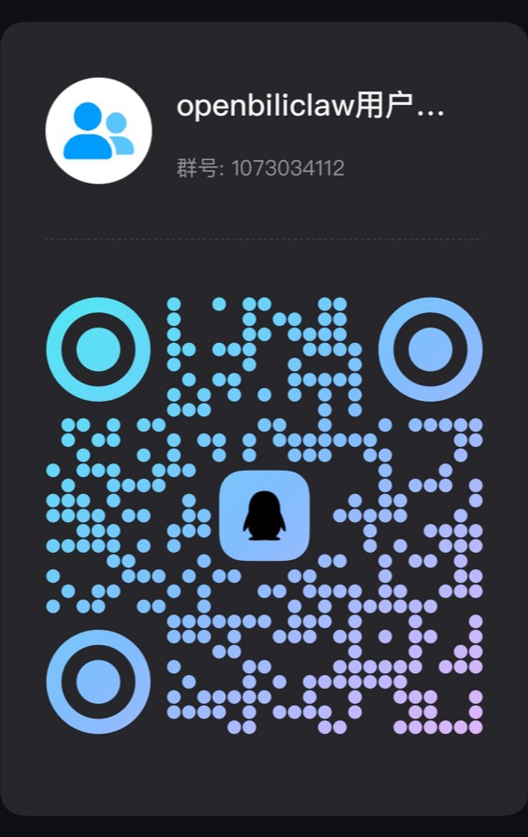
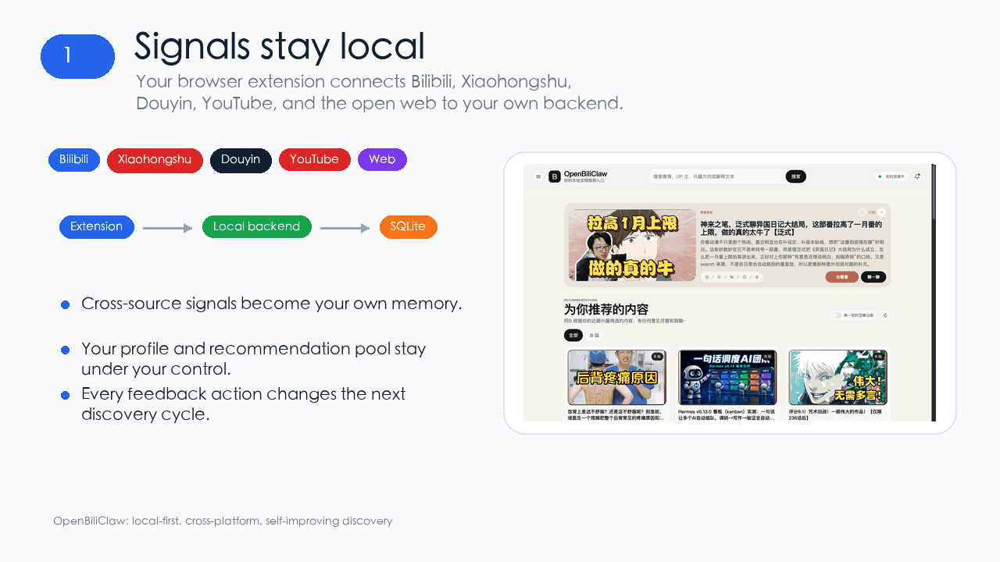
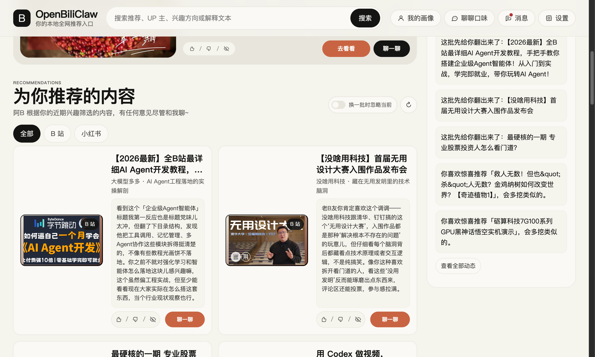
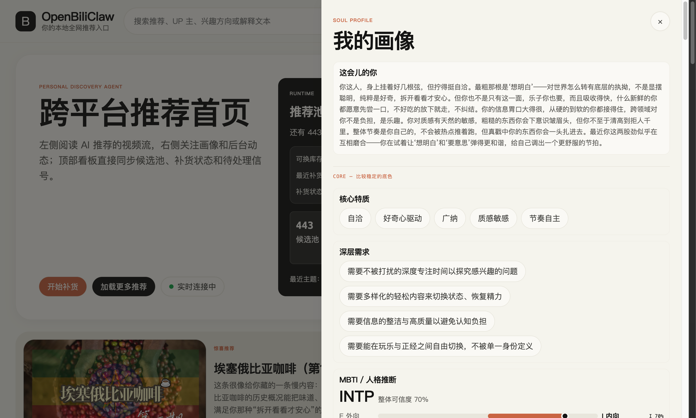
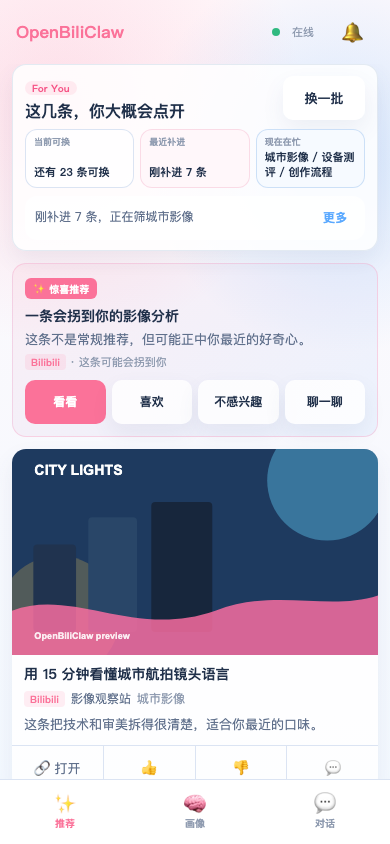
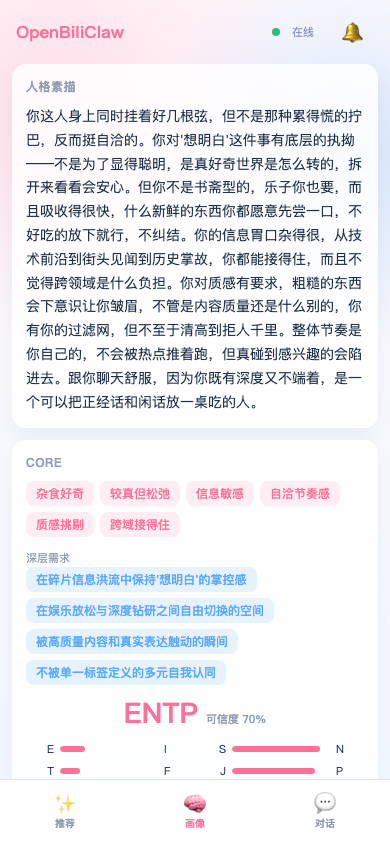
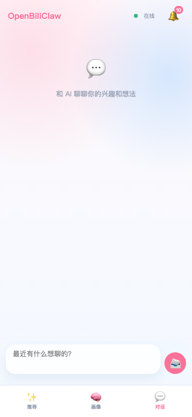
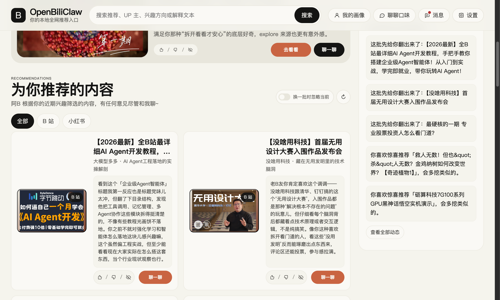

<div align="center">

# 🦀 OpenBiliClaw

**A general-purpose personalized content discovery Agent — runs locally, understands you across platforms, built only for you**

[](https://opensource.org/licenses/MIT)
[](https://www.python.org/downloads/)
[](https://github.com/whiteguo233/OpenBiliClaw/releases/latest)
[](https://github.com/whiteguo233/OpenBiliClaw/releases)
[](https://github.com/whiteguo233/OpenBiliClaw)
[](https://github.com/whiteguo233/OpenBiliClaw/actions/workflows/ci.yml)
[](https://linux.do/t/topic/1978894)
[](https://chromewebstore.google.com/detail/cdfjfkdjjhdaccbldipkjhpibnfbiamg)
[](https://gitee.com/whiteguo233/OpenBiliClaw)
[](https://dshfind.com/zh/plugins)

[Homepage](https://whiteguo233.github.io/OpenBiliClaw/) | English | [中文](README.md)

China code mirror: [OpenBiliClaw on AtomGit](https://atomgit.com/whiteguo233/OpenBiliClaw)

</div>

<p align="center">
  <picture>
    <source media="(prefers-color-scheme: dark)" srcset="https://whiteguo233.github.io/OpenBiliClaw/images/siliconflow-logo-dark.png">
    
  </picture>
  <br>
  <sub>Model compute support: thanks to <a href="https://www.siliconflow.cn">SiliconFlow</a> for free model credits and inference support · <a href="docs/partners.md">Partnership details</a></sub>
</p>

> ### 🆕 Big update: OpenBiliClaw now runs inside DeepSeek Harness
>
> New **DSH client plugin** — install OpenBiliClaw into [DeepSeek Harness](https://github.com/deepseek-ai/DeepSeek-Harness): a persistent fourth column (Recommendations / Library / Chat / Profile / Settings) in the DSH web GUI, plus 22 Agent Bridge tools so agents can read recommendations, answer probes, and close the learning loop — browse cross-platform personalized content while you work in DSH. → [`github.com/whiteguo233/dsh-openbiliclaw`](https://github.com/whiteguo233/dsh-openbiliclaw)
>
> 📱 Want a native app? The Flutter mobile client (Android / iOS / Web / desktop) lives in the separate repo [`OpenBiliClaw-mobile`](https://github.com/whiteguo233/OpenBiliClaw-mobile): recommendations, chat, profile, favorites / watch-later / 30-day history — all talking to the same local backend.

> 🇨🇳 **Mainland China sources**: [Gitee](https://gitee.com/whiteguo233/openbiliclaw/tree/main) and [AtomGit](https://atomgit.com/whiteguo233/OpenBiliClaw) host source mirrors. Get the latest installers and extension packages from [GitHub Release](https://github.com/whiteguo233/OpenBiliClaw/releases/latest) ([123 Cloud](https://4001474255.share.123pan.cn/123pan/IxbZMh-90KO3) currently holds v0.3.213 archive files only).

## 💬 Community

<div align="center">

<table>
  <tr>
    <td align="center" valign="middle" width="420">
      <br/>
      <b>QQ Community</b><br/>
      <sub>Group <code>1073034112</code> · Scan to join</sub>
    </td>
    <td align="center" valign="middle" width="420">
      <a href="https://discord.gg/PU6Xgch8yg"></a><br/>
      <b>Discord Community</b><br/>
      <sub>Scan or <a href="https://discord.gg/PU6Xgch8yg">click to join</a> — invite never expires</sub>
    </td>
  </tr>
</table>

</div>

## OpenBiliClaw in 10 Seconds

A local-first, private, open-source, self-improving content discovery Agent. It continuously deepens a five-layer psychological profile from your cross-platform activity, feedback, and chat, then proactively searches **Bilibili, Xiaohongshu (RedNote), Douyin, YouTube, TikTok, X, Zhihu, Reddit, Linux.do, Bangumi, V2EX, Weibo, GitHub, Instagram**, plus **any website or RSS feed** you describe in chat.

| Cross-platform | Zero-setup free models | Local-first | Trainable |
|---|---|---|---|
| 14 built-in platforms + custom websites / RSS in one loop | Preconfigured free LLMs & embeddings work out of the box | Profiles, history, and pools stay in your local SQLite | Likes, dislikes, chat, and probes refine future picks |

<p align="center">
  <a href="https://chromewebstore.google.com/detail/cdfjfkdjjhdaccbldipkjhpibnfbiamg"><b>Install browser extension</b></a>
  ·
  <a href="https://github.com/whiteguo233/OpenBiliClaw/releases/latest"><b>Download desktop installer</b></a>
  ·
  <a href="#quick-start"><b>4-step Quick Start</b></a>
  ·
  <a href="https://github.com/whiteguo233/OpenBiliClaw"><b>⭐ Star on GitHub</b></a>
</p>

<p align="center">
  
</p>

## Quick Start

Four steps for most users. Firefox / Safari, Docker, shell script, and manual source setup live in [Setup Details](#setup-details).

1. **Install the extension** — one-click from the [Chrome Web Store](https://chromewebstore.google.com/detail/cdfjfkdjjhdaccbldipkjhpibnfbiamg) (auto-updates for Chrome / Edge / Brave / Arc), or grab the latest zip / Firefox / Safari package from [Latest Release](https://github.com/whiteguo233/OpenBiliClaw/releases/latest).
2. **Install the backend (pick one)**
   - **Easiest · Desktop installer**: download the macOS `.dmg` (Apple Silicon / Intel) or Windows `Setup.exe` from [Latest Release](https://github.com/whiteguo233/OpenBiliClaw/releases/latest). Lives in your menu bar / tray with free models and local BGE-M3 support ready out of the box.
   - **Customizable · Let an AI coding agent deploy it**: paste this into Claude Code, Codex CLI, Cursor, or Windsurf:
     ```text
     Please follow https://raw.githubusercontent.com/whiteguo233/OpenBiliClaw/main/docs/agent-install.md to deploy the OpenBiliClaw backend for me (use Bash `curl` to fetch the document, NOT WebFetch — WebFetch summarises markdown and drops critical commands).
     ```
3. **Connect sources & initialize** — log in to [Bilibili](https://www.bilibili.com) (default init source) in the browser with the extension installed, or enable Xiaohongshu / Douyin / YouTube / X / Zhihu / Reddit / Linux.do / Bangumi / V2EX / Weibo / GitHub / TikTok / Instagram, then click through the guided setup to generate your first profile (or paste any website / RSS URL in Chat).
4. **Open your preferred surface**
   - **Desktop Web**: visit `http://127.0.0.1:8420/web` (or `http://127.0.0.1:8420/`)
   - **Browser sidebar**: click the OpenBiliClaw extension icon on any supported site
   - **Mobile**: scan the extension header QR code to open `http://<your-LAN-IP>:8420/m/` (save to Home Screen), or install the native [Flutter client](https://github.com/whiteguo233/OpenBiliClaw-mobile) (Android / iOS include embedded [Tailnet](docs/modules/tailnet.md) access away from home)

## 📸 Feature Preview

One local backend, five coordinated surfaces: the **browser extension** handles in-page interaction, sessions, and read-only tasks; **Desktop Web (`/web`)** offers a full-screen dashboard with live runtime status; **Mobile Web (`/m`)** is tuned for phones; the separate **Flutter native app** ([OpenBiliClaw-mobile](https://github.com/whiteguo233/OpenBiliClaw-mobile)) runs across Android / iOS / desktop; and the **DSH client plugin** ([dsh-openbiliclaw](https://github.com/whiteguo233/dsh-openbiliclaw)) brings recommendations plus 22 Agent Bridge tools right inside DeepSeek Harness.

<div align="center">

<table>
  <tr>
    <td align="center" width="50%">
      <br/>
      <b>Desktop Home</b><br/>
      <sub>Surprise pick hero · recommendation grid · friend-like reasons</sub>
    </td>
    <td align="center" width="50%">
      <br/>
      <b>Soul Profile + Live Activity</b><br/>
      <sub>Personality sketch · core traits · deep needs · MBTI · background learning</sub>
    </td>
  </tr>
</table>

<table>
  <tr>
    <td align="center" width="25%">
      <br/>
      <b>Mobile Feed</b><br/>
      <sub>Surprise pick + pool status · friend-like reasons</sub>
    </td>
    <td align="center" width="25%">
      <br/>
      <b>Smart Feedback Loop</b><br/>
      <sub>Like / later / save / less / tell why</sub>
    </td>
    <td align="center" width="25%">
      <br/>
      <b>Natural-Language Portrait</b><br/>
      <sub>Explains *why* you like things</sub>
    </td>
    <td align="center" width="25%">
      <br/>
      <b>Chat Tuning & Add Sites</b><br/>
      <sub>Steer taste or paste a URL to subscribe</sub>
    </td>
  </tr>
</table>

</div>

<details>
<summary>More screenshots (traits · values · cognitive style · mobile profile & chat)</summary>

<div align="center">

<table>
  <tr>
    <td align="center" width="33%">
      <br/>
      <b>Structured Traits</b><br/>
      <sub>MBTI · core traits · deep needs</sub>
    </td>
    <td align="center" width="33%">
      <br/>
      <b>Values & Speculative Interests</b><br/>
      <sub>Inner drivers · new interest bridges</sub>
    </td>
    <td align="center" width="33%">
      <br/>
      <b>Cognitive Style</b><br/>
      <sub>Information processing · content taste</sub>
    </td>
  </tr>
  <tr>
    <td align="center" width="33%">
      <br/>
      <b>Mobile Profile</b><br/>
      <sub>Inspect & calibrate on the go</sub>
    </td>
    <td align="center" width="33%">
      <br/>
      <b>Mobile Chat</b><br/>
      <sub>Shared main history across surfaces</sub>
    </td>
    <td align="center" width="33%">
      <br/>
      <b>Desktop Card Grid</b><br/>
      <sub>Widescreen grid & instant feedback</sub>
    </td>
  </tr>
</table>

</div>

</details>

## Recent Updates

📌 Latest: **v0.3.239 (2026-11-16)**

- **Choose the Windows install folder**. Interactive installs and upgrades both show Select Destination Location, prefilled with the previous folder.
- **More complete free-model profiles**. Initial profiles keep the core and values layers, and unknown MBTI is marked pending.
- **Roomier chat layout**. Desktop and popup fold non-chat chrome away, so small windows show far more conversation.
- **Popup settings layout fixed**. The blank stretch and narrow-width clipping are gone, and saving still works at 320px.

Full changelog: [docs/changelog.md](docs/changelog.md).

## Why OpenBiliClaw?

> The name comes from Bilibili (`Bili` = Bilibili, `Claw` = "the claw that grabs content for you") — the project started as a Bilibili-only tool. Since v0.3.0 it has evolved into a general cross-platform Agent covering Bilibili, Xiaohongshu, Douyin, YouTube, TikTok, X, Zhihu, Reddit, Linux.do, Bangumi, V2EX, Weibo, GitHub, Instagram, and custom websites / RSS.

Recommendation algorithms are essentially a **middleman** balancing engagement, ad revenue, and creator retention — your satisfaction is only a byproduct. Worse, every platform is a data silo: what you learn on Bilibili, bookmark on Xiaohongshu, and star on GitHub never connect into one picture of you.

**OpenBiliClaw flips the order** — understand *who you are* first, then send an Agent across the web on your behalf:

- 🧠 **Understands *why* you like things**: builds a five-layer soul profile (Event → Preference → Awareness → Insight → Soul), inferring MBTI, cognitive style, and deep psychological drivers.
- 🔮 **Actively breaks your filter bubble**: uses psychological bridging to hypothesize unexplored domains (e.g., mechanical watches → architectural aesthetics), promoting accurate guesses and quietly retiring misses.
- 🔒 **100% local, 100% yours**: behavior, profiles, candidate pools, and chat history stay in SQLite on your disk. Use preconfigured free models, bring your own API keys, or experimentally reuse local Codex CLI OAuth — no OpenBiliClaw cloud account required.

> | | Platform Official Feeds | Keyword Filter Plugins | OpenBiliClaw |
> |---|---|---|---|
> | Recommendation logic | Collaborative filtering / ad weights | Rules / tag matching | Psychological profile + 5-layer memory + chat |
> | Content sources | Single platform | Single platform | 14 platforms + custom websites / RSS mixed in one feed |
> | Filter bubble | Gets narrower | Doesn't address it | Interest probes proactively expand horizons |
> | Data ownership | Platform-owned | Usually cloud | 100% local SQLite |
> | Explanations | "Guess you'll like" | None | Friend-like reasoning tailored to you |
> | Customizability | None | Low | Swap LLMs / edit profile / add sites / plug in Agents |

## ✨ Key Features

### Understanding & Recommendations
- 🧠 **Five-Layer Soul Profile** — Event → Preference → Awareness → Insight → Soul, capturing personality sketches, MBTI, cognitive style, and deep needs ([module docs](docs/modules/soul.md)).
- 🔮 **Interest & Avoidance Probes** — proactively hypothesizes potential interests and content boundaries with four-state confirmation; nothing is filtered until you confirm.
- 💬 **Warm Explanations & Surprise Queue** — every card explains *why* it fits you like a friend; top-scoring gems surface in the Surprise Pick hero.
- 🎯 **Smart Diversity & Instant Reshuffle** — topic quotas + cross-platform interleaving + small-source protection, ~0.6s deduplicated reshuffle excluding seen and disliked items.

### Cross-Platform & Custom Web
- 🌐 **14 Built-in Platforms** — video, short posts, Q&A, developer hubs, and anime databases unified in one pipeline.
- 🕸️ **Add Any Website or RSS in Chat** — paste an RSS/Atom/JSON Feed or website URL plus what you want to read in Chat, review a live trial, and schedule recurring discovery; macOS ships managed **Ego Lite** with an in-app human login takeover page for authenticated sites ([details](docs/modules/web.md)).

### Multi-Surface & Agent Ecosystem
- 🧩 **Full Browser Extension** — Chrome / Edge / Brave / Arc / Firefox / Safari support for sidebar recommendations, feedback, and same-origin read-only tasks.
- 🖥️ **Desktop / Mobile Web & Flutter App** — built-in `/web` desktop dashboard and `/m/` mobile PWA, plus the separate [OpenBiliClaw-mobile](https://github.com/whiteguo233/OpenBiliClaw-mobile) Flutter app for Android, iOS, and desktop.
- 🛜 **Embedded Tailnet Access** — desktop and native Android / iOS apps embed `tsnet` so you can connect home across networks without system-wide Tailscale or a public Funnel ([details](docs/modules/tailnet.md)).
- 🤖 **OpenClaw / Hermes / DSH Integration** — ships `agent-bridge/v2` and a workspace skill so external Agents can push surprise picks, ask probes, read profiles, and record feedback ([quickstart](docs/openclaw-quickstart.md)).

### Private, Free-Friendly & Controllable
- 🆓 **Built-in Free Models & Local Vectors** — preconfigured SiliconFlow free LLMs (Qwen3-8B / Qwen3.5-4B) and cloud BGE-M3 work out of the box, alongside Ollama local `bge-m3` or any OpenAI / Anthropic / Gemini / DeepSeek endpoint.
- ⭐ **Local-First Saves & 30-Day History** — favorites and watch-later write to SQLite first (auto-sync is off by default; when enabled, syncs back to Bilibili + 6 platforms); 30-day history unifies opened, surfaced, and recently removed items across surfaces.
- 📦 **Cross-Machine Migration & Multimodal Bonus** — `.obcbackup` export/import with validation and rollback; optional cover, keyframe, and danmaku visual weighting ([details](docs/modules/recommendation.md)).

## 🌐 Supported Content Sources

| Source | Discovery Modes | Access & Auth Boundary | Docs |
|---|---|---|---|
| **Bilibili** | Search · trending · related chain · explore | Backend WBI-signed API; log in via extension browser for history/favorites/follows | [bilibili.md](docs/modules/bilibili.md) |
| **Xiaohongshu** | Passive capture · search · creators · init | Extension reads logged-in pages; zero backend crawling | [discovery.md](docs/modules/discovery.md) |
| **Douyin** | Init · search · hot · feed | Extension triggers home-page DOM actions and collects responses via formal scheduler | [discovery.md](docs/modules/discovery.md) |
| **YouTube** | Init · Takeout import · search / trending / channel | Extension reads watch history/subs/likes; backend refills steady-state candidates | [youtube.md](docs/modules/youtube.md) |
| **TikTok** | Feed · hashtag · creator · signed-in search | Disabled by default; guest discovery needs no login, search syncs extension cookie, needs overseas access | [tiktok.md](docs/modules/tiktok.md) |
| **X (Twitter)** | Init · search · For-You · followed authors | Backend read-only replay (`twitter-cli`) with extension-synced cookies; text cards | [source-auth.md](docs/modules/source-auth.md) |
| **Zhihu** | Init · search · hot · feed · creator · related | Read-only extension tasks inside logged-in tabs; text cards | [zhihu.md](docs/modules/zhihu.md) |
| **Reddit** | Init · search · hot · subreddit · related | Defaults to `rdt-cli` with extension-synced session, falling back to extension tasks | [source-auth.md](docs/modules/source-auth.md) |
| **Linux.do** | Bookmarks/likes/read init · 5-mode discovery | Public discovery needs no login; personal signals run same-origin GETs (`_t` stays browser-local) | [linuxdo.md](docs/modules/linuxdo.md) |
| **Bangumi** | Public-collection init · search · ranked · date | Official anonymous read-only v0 API; optional public username or PAT | [bangumi.md](docs/modules/bangumi.md) |
| **V2EX** | Search · Node · Tab · hot · latest | Anonymous API/Feed; signed-in extension or optional PAT reads favorites & replies | [v2ex.md](docs/modules/v2ex.md) |
| **Weibo** | Init · search · hot · creator | Backend runs anonymous public discovery; personal init uses same-origin extension tasks | [weibo.md](docs/modules/weibo.md) |
| **GitHub** | Starred-repo init · search · ranked · latest | Official REST API anonymously for public repos; optional PAT for rate limits, no extension | [github.md](docs/modules/github.md) |
| **Instagram** | Topic/creator discovery · likes/saves/follows init | Disabled by default; bounded import in logged-in browser, needs overseas access ([scope](docs/platform-source-acceptance.instagram.md)) | [instagram.md](docs/modules/instagram.md) |
| **Custom Web / RSS** | Chat authoring · live trial · human takeover · schedule | Feeds use bounded anonymous HTTP; dynamic websites use managed Ego Lite on macOS | [web.md](docs/modules/web.md) |

> **Data boundaries**: OpenBiliClaw never stores your platform passwords or bypasses login. Periodic account re-pull is off by default (signals are pulled only when you click "Start initialization" or opt in). Out of the box only Bilibili is enabled; enable other sources in Settings. Full contracts: [docs/modules/source-auth.md](docs/modules/source-auth.md).

## 🤖 Integrate with OpenClaw / Hermes / WorkBuddy Agents

This repository includes a [workspace skill](skills/openbiliclaw-adapter/SKILL.md) and versioned Agent Bridge (`agent-bridge/v2`). Paste this into OpenClaw, Claude Code, Codex CLI, or Cursor to connect it to your local OpenBiliClaw instance:

```text
Please follow https://raw.githubusercontent.com/whiteguo233/OpenBiliClaw/main/docs/openclaw-quickstart.md to integrate this repository into the Agent Bridge (target host: OpenClaw; use Bash `curl` to fetch the document, NOT WebFetch — WebFetch summarises markdown and drops critical commands).
```

<details>
<summary>Example workflows (proactive surprise push · interest probing · on-demand picks)</summary>

1. **Proactive surprise recommendations**: when background discovery finds a high-scoring gem, `delight.candidate` pushes to the host via WebSocket and records your feedback idempotently.
2. **Proactive interest / avoidance probing**: `interest.probe` invites confirmation and Socratic follow-up dialogue, updating your Soul profile directly.
3. **On-demand requests**: ask "Recommend three Bilibili videos worth watching today" — the host calls `recommend --limit 3` while keeping every byte of your profile local.

Full command reference: [OpenClaw Quickstart](docs/openclaw-quickstart.md) and [Agent Bridge Contract](docs/agent-integration.md).

</details>

## Setup Details

### 1. Install the browser extension

Built on Manifest V3 for **Chrome, Edge, Brave, Arc, Vivaldi, Opera**, plus **Firefox (140+)** and **Safari (macOS)** builds.

- **Latest release build (recommended)**: open [OpenBiliClaw Latest Release](https://github.com/whiteguo233/OpenBiliClaw/releases/latest) (the user-facing `openbiliclaw-v*` aggregate page):
  - Chrome / Edge / Brave: download `openbiliclaw-extension-v*.zip`, enable Developer mode on `chrome://extensions/`, and drag the zip onto the page.
  - Firefox: install the signed `openbiliclaw-extension-v*-firefox.xpi` when present, or load `*-firefox.zip` temporarily via `about:debugging`.
  - Safari (macOS): download `openbiliclaw-extension-v*-safari.dmg`, launch the app once, and enable OpenBiliClaw in Safari Settings → Extensions (see [Safari build guide](docs/safari-extension-build.md)).
- **One-click auto-updates**: install from the [Chrome Web Store](https://chromewebstore.google.com/detail/cdfjfkdjjhdaccbldipkjhpibnfbiamg) (can lag Releases by a few days due to store review).

<details>
<summary>Firefox source build & temporary debugging</summary>

```bash
git clone https://github.com/whiteguo233/OpenBiliClaw.git
cd OpenBiliClaw/extension
npm install
npm run build:firefox          # writes dist-firefox/
npm run package:firefox        # creates unsigned zip
```

Open `about:debugging#/runtime/this-firefox`, click "Load Temporary Add-on…", and pick `manifest.json` from the unzipped folder or `extension/dist-firefox/`. Temporary add-ons unload when Firefox restarts; regular users should prefer signed `.xpi` or store builds.

</details>

### 2. Deploy the backend

#### Option A: Download the desktop installer (easiest)

Grab your OS package from the `openbiliclaw-v*` aggregate [Latest Release](https://github.com/whiteguo233/OpenBiliClaw/releases/latest) (same-version showcase across `backend-v*` / `extension-v*` / `desktop-v*`; unpublished channels are shown as unpublished rather than backfilled):

- **macOS**: download `OpenBiliClaw-macos-v*-arm64.dmg` (Apple Silicon) or `OpenBiliClaw-macos-v*-x64.dmg` (Intel when available). Quit any old version, open the DMG, and drag the app into Applications or another writable folder before launching (replace the existing app in place when upgrading).
  > **macOS signing and notarization**: CI enforces Developer ID signing and Apple notarization; no manual quarantine removal is needed. See [packaging docs](docs/modules/packaging.md).
- **Windows**: download `OpenBiliClaw-windows-*-Setup.exe` and double-click to install, with customizable destination folder (upgrades prefill the existing path). If SmartScreen prompts, click "More info → Run anyway".

Both Apple Silicon and Windows ship **lean** and **`-with-embedding`** installers (preloaded local BGE-M3, ~1.1GB); macOS targets 10.15+ (the optional embedded Tailnet helper requires macOS 12+). The app lives in the menu bar / system tray and stores data in `~/OpenBiliClaw` (or `%USERPROFILE%\OpenBiliClaw` on Windows).

#### Option B: AI one-line deploy (editable source / deep customization)

```text
Please follow https://raw.githubusercontent.com/whiteguo233/OpenBiliClaw/main/docs/agent-install.md to deploy the OpenBiliClaw backend for me (use Bash `curl` to fetch the document, NOT WebFetch — WebFetch summarises markdown and drops critical commands).
```

<details>
<summary>Alternative: Shell / PowerShell one-line installer scripts</summary>

**macOS / Linux / WSL2**:
```bash
curl -fsSL https://raw.githubusercontent.com/whiteguo233/OpenBiliClaw/main/scripts/install.sh | bash
```

**Native Windows (PowerShell, no Docker or WSL2 required)**:
```powershell
[Net.ServicePointManager]::SecurityProtocol = [Net.ServicePointManager]::SecurityProtocol -bor [Net.SecurityProtocolType]::Tls12; iwr https://raw.githubusercontent.com/whiteguo233/OpenBiliClaw/main/scripts/install.ps1 -UseBasicParsing | iex
```

Requires `git` and Python 3.11+. Walks through LLM, embedding, and source opt-ins, verifies connectivity, prepares private Ego Lite on macOS, and runs `init` automatically.

</details>

<details>
<summary>Alternative: Docker Compose (with Ollama sidecar)</summary>

```bash
mkdir -p ~/openbiliclaw && cd ~/openbiliclaw
curl -fsSLO https://raw.githubusercontent.com/whiteguo233/OpenBiliClaw/main/docker-compose.prebuilt.yml
docker compose -f docker-compose.prebuilt.yml up -d
docker exec -it openbiliclaw-backend openbiliclaw set-password
docker restart openbiliclaw-backend
# sign in at http://127.0.0.1:8420/web/, then open /setup/
```

See [Docker Deployment Guide](docs/docker-deployment.md) and [HTTPS Deployment Guide](docs/https-deployment.md) (Caddy automatic TLS for public domains).

</details>

<details>
<summary>Advanced: Local Ollama Embedding · Remote/Tailnet Access · Manual CLI</summary>

- **Local Ollama Embedding**: install [Ollama](https://ollama.com/download) and run `uv run openbiliclaw setup-embedding` to pull `bge-m3` (runs on CPU).
- **LAN / Remote Access Security**: with `[api.auth].enabled=false`, private APIs are trusted-local only. Before connecting phones, LAN clients, or reverse proxies, enable an app password in Settings or run `openbiliclaw set-password`; remote extensions also pair via `openbiliclaw ext-key generate` / `enable` ([API Auth](docs/modules/api-auth.md) · [Mobile Connection](docs/mobile-connection.md)).
- **Embedded Tailnet**: desktop installers bundle the helper — enable **Settings → General → Embedded Tailnet access** and restart to connect native Android / iOS apps remotely. Source installs need Go 1.26.6 plus `openbiliclaw tailnet build-helper` and `openbiliclaw tailnet enable` ([Tailnet Docs](docs/modules/tailnet.md)).
- **Manual source install & CLI**:
  ```bash
  git clone https://github.com/whiteguo233/OpenBiliClaw.git && cd OpenBiliClaw
  uv sync && cp config.example.toml config.toml
  openbiliclaw init        # Build initial profile & first discovery
  openbiliclaw start       # Start backend (Web UI at http://127.0.0.1:8420/web)
  openbiliclaw discover    # Run manual discovery
  openbiliclaw recommend   # View recommendations in terminal
  openbiliclaw profile     # View soul profile in terminal
  ```
  Full reference: [CLI Docs](docs/modules/cli.md), [Config Docs](docs/modules/config.md), and [Deployment Troubleshooting](docs/agent-deployment.md).

</details>

## 🏛️ Architecture Overview

```text
┌───────────────────────────────────────────────────────────────────────────────┐
│                                 User Surfaces                                 │
│  Browser Extension (Chrome/Edge/Firefox/Safari) · Desktop Web (/web) · (/m)   │
│  Flutter Native App (OpenBiliClaw-mobile) · DSH Plugin · Agent Hosts          │
└───────────────────────────────────────┬───────────────────────────────────────┘
                                        │ Local HTTP / WebSocket (127.0.0.1 / LAN)
                                        │ Optional: Embedded Tailnet · Caddy HTTPS · TLS Proxy
┌───────────────────────────────────────▼───────────────────────────────────────┐
│                      Local FastAPI Backend & Runtime Loop                     │
│   Concurrency Gates · Background Refill · Presence · Cross-Process Budgets    │
├───────────────────┬───────────────────┬───────────────────┬───────────────────┤
│    Soul Engine    │   Memory System   │ Discovery Engine  │  Recommendation   │
│ 5-Layer Profiling │ Layered Networked │  15-Source Pool   │ Mix · Diversity   │
│  & Probe Dialogue │   Memory Store    │  & Jev/LLM Eval   │ & Warm Reasons    │
├───────────────────┴───────────────────┴───────────────────┴───────────────────┤
│  LLM & Embedding Routing (Free SiliconFlow Qwen/BGE-M3 · Ollama · Failover)   │
│  LLM Costing: catalog · daily CNY cap/reserve · peak windows · routing        │
│  Local SQLite Store (Events · Profile · Pool · Seen Ledger · Chat · Library)  │
└───────────────────────────────────────────────────────────────────────────────┘
```

> Detailed subsystem diagrams (concurrency gates, Jev evaluation, Director mode, managed Ego Lite, and per-source task state machines) live in dedicated architecture docs to keep this README concise:
> - [Architecture Overview Diagrams](docs/architecture-overview.en.md) ([中文](docs/architecture-overview.md))
> - [System Architecture Deep Dive](docs/architecture.md) · [Interactive Visual Diagrams](docs/index.md#可视化架构图)
> - Core modules: [Soul Engine](docs/modules/soul.md) · [Discovery Engine](docs/modules/discovery.md) · [Recommendation Engine](docs/modules/recommendation.md)

<details>
<summary>Project Structure & Tech Stack</summary>

```text
OpenBiliClaw/
├── src/openbiliclaw/          # Python backend core
│   ├── agent/                 # Agent orchestration, chat loop & Skill system
│   ├── soul/                  # 5-layer soul profile, MBTI, probes & settlement
│   ├── memory/                # Multi-layer networked memory
│   ├── discovery/             # Strategies, candidate pool, Jev/LLM eval & diversity
│   ├── recommendation/        # Ranking, delight queue, explanations & Director mode
│   ├── sources/               # 15 source adapters, task bridges & Ego Lite / HTTP workflows
│   ├── api/                   # FastAPI server, auth, migration & worker subprocesses
│   ├── runtime/               # Refresh loop, presence tracker, autostart & updater
│   ├── llm/                   # Multi-instance routing, prompt caching & structured tolerance
│   ├── i18n/                  # Simplified / Traditional Chinese & English catalogs
│   ├── web/                   # Built-in Desktop (/web), Mobile (/m) & Setup (/setup) UIs
│   └── storage/               # SQLite persistence & incremental schema migrations
├── extension/                 # Chrome / Edge / Firefox / Safari (Manifest V3) extension
├── packaging/                 # macOS DMG / Windows installer & system-tray entry
├── skills/                    # Built-in workspace skill (OpenClaw / Agent Bridge)
├── docs/                      # Module docs, diagrams, acceptance ledgers & homepage
└── tests/                     # 10,000+ automated unit & contract tests
```

| Layer | Technology |
|---|---|
| Backend & Storage | Python 3.11+ · FastAPI · APScheduler · SQLite + Embedding vector index |
| Browser Extension | TypeScript · Manifest V3 (`sidePanel` / Firefox `sidebar_action` / Safari Web Extension) |
| LLMs & Embeddings | Ordered multi-instance failover (preconfigured SiliconFlow Qwen3 / BGE-M3 · DeepSeek · OpenAI · Claude · Gemini · OpenRouter · Ollama · any OpenAI-compatible API) |
| Packaging & Networking | Desktop bundles (PyInstaller + notarized DMG / Inno Setup) · Docker Compose · embedded `tsnet` · Caddy / built-in TLS Proxy |

</details>

## 📖 Documentation & Ecosystem

- [Documentation Hub](docs/index.md) — unified entry point for users and contributors
- [FAQ](docs/faq.md) — quick answers for install, connection, updates, and migration
- [Architecture](docs/architecture.md) · [Project Spec](docs/spec.md) · [Memory Design](docs/memory-design.md)
- [CLI Reference](docs/modules/cli.md) · [Config Reference](docs/modules/config.md) · [Changelog](docs/changelog.md)
- [Flutter Mobile Client](https://github.com/whiteguo233/OpenBiliClaw-mobile) · [DSH Client Plugin](https://github.com/whiteguo233/dsh-openbiliclaw)

## 🗺️ Roadmap

- **More content sources** — vertical communities and specialized forums adhering to shared source contracts and acceptance gates.
- **Deeper cross-platform interest fusion** — weaving video, long-form reading, short posts, and open-source signals into cross-source discovery.
- **Open plugin ecosystem** — community-contributed `SourceAdapter` modules and shared discovery workflows.

## 🤝 Contributing & Acknowledgements

Contributions are welcome! See the [Contributing Guide](docs/contributing.md) to get started.

Huge thanks to all contributors: [@addtion99](https://github.com/addtion99) ([#8](https://github.com/whiteguo233/OpenBiliClaw/pull/8)), [@jiaobenhaimo](https://github.com/jiaobenhaimo) ([#53](https://github.com/whiteguo233/OpenBiliClaw/pull/53)), [@tangle111-design](https://github.com/tangle111-design) ([#69](https://github.com/whiteguo233/OpenBiliClaw/pull/69)), [@DongLanQwQ0](https://github.com/DongLanQwQ0) ([#102](https://github.com/whiteguo233/OpenBiliClaw/pull/102), [#110](https://github.com/whiteguo233/OpenBiliClaw/pull/110)), [@wuwafly3](https://github.com/wuwafly3) ([#100](https://github.com/whiteguo233/OpenBiliClaw/pull/100), [#135](https://github.com/whiteguo233/OpenBiliClaw/pull/135)), [@LHMQ878](https://github.com/LHMQ878) ([#182](https://github.com/whiteguo233/OpenBiliClaw/pull/182)), [@Patrick5D](https://github.com/Patrick5D) ([#179](https://github.com/whiteguo233/OpenBiliClaw/pull/179)), [@OctoBored](https://github.com/OctoBored) ([#196](https://github.com/whiteguo233/OpenBiliClaw/pull/196)), [@CoderJackZhu](https://github.com/CoderJackZhu) ([#348](https://github.com/whiteguo233/OpenBiliClaw/pull/348)), and [@jjjj31](https://github.com/jjjj31) ([#351](https://github.com/whiteguo233/OpenBiliClaw/pull/351)).

## ⭐ Star History

If OpenBiliClaw gave you back control of your feed, [a star](https://github.com/whiteguo233/OpenBiliClaw) is the most direct vote for "keep adding platforms".

<a href="https://star-history.dera.page/#whiteguo233/OpenBiliClaw&amp;type=date">
 <picture>
   <source media="(prefers-color-scheme: dark)" srcset="https://star-history.dera.page/svg?repos=whiteguo233/OpenBiliClaw&amp;type=date&amp;theme=dark&amp;legend=top-left" />
   <source media="(prefers-color-scheme: light)" srcset="https://star-history.dera.page/svg?repos=whiteguo233/OpenBiliClaw&amp;type=date&amp;legend=top-left" />
   
 </picture>
</a>

## Privacy at a glance

Default data flow: browser extension → your local OpenBiliClaw backend → SQLite and data files on your disk. The extension sends nothing to servers operated by OpenBiliClaw developers; Linux.do `_t` stays a browser-local login boolean without uploading cookies or raw responses. When you configure or enable cloud LLMs / embeddings, only task-required text and profile context go to your chosen model provider. Exported `.obcbackup` archives exclude API passwords and device keys, but contain model/source keys, cookies, and profiles in **plaintext**, so share them only between trusted devices. See [Privacy Policy](docs/privacy.md).

## 📄 License

[MIT](LICENSE)

<details>
<summary>Friend Links</summary>

[](https://linux.do/)

</details>
