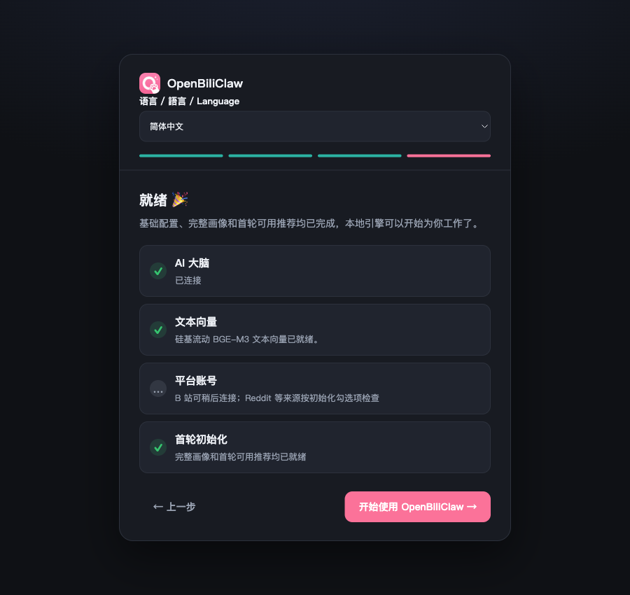

# 免费方案全面复测：业务、四端与真实进程恢复（2026-11-05）

本轮结论：四种配置的基础业务矩阵 56/56 通过，真实首次初始化、插件/PC/手机共享会话和模型切换可用。发现并修复四项产品问题。但扩展验收仍出现模型内容错误、默认规划预算不足，以及高负载下本地向量探测超时；不能据此宣称任一模型可靠完成所有任务。

代码：PR [#336](https://github.com/whiteguo233/OpenBiliClaw/pull/336)。修复提交 `318c4b4d`、`c2509384`；此前 CI 词库修复为 `a6527118`。未合并 main，未发布主程序。

## 环境与判定方法

- 本机 macOS Intel，真实 Chrome 插件、PC Web、390×844 手机 Web 视口、CLI；手机 Web 不是手机硬件验收。
- 正式签名组件 `sponsored-runtime-2026-11-05.1`，真实 Rust IPC、硅基流动请求、SQLite 和业务模块。正常验收关闭付费回退及两个免费模型之间的自动回退，防止结果由其他模型代答。配置切换案例显式切换到另一模型。
- 两个聊天模型分别搭配云端 BAAI/bge-m3、本地 Ollama bge-m3，共四组。各组都是 12 条合成行为、30 条候选，模型、业务实现和存储没有 mock。公开 B站搜索、GitHub 数据获取另有真实请求。
- 初次失败、脚本修正后结果、产品修复后结果分别保存。接口 200、模型 HTTP 成功、业务断言通过、内容忠实性是不同指标。
- 四组业务库合计记录 222 次 LLM 调用，729,788 输入 token、165,212 输出 token；不包含直接 SDK 探针、embedding 或连接测试，不能当作总请求/额度统计。成功调用覆盖 20 个业务 caller，见[记录](assets/2026-11-05-sponsored-comprehensive/caller-coverage.json)。[111 处静态调用点清单](assets/2026-11-05-sponsored-comprehensive/task-inventory.json)不是 111 个真实任务均已执行的证明。

## 基础业务与 HTTP 矩阵

| 配置 | 基础业务 | HTTP 扩展首次结果 | 首次未通过项 |
|---|---:|---:|---|
| 8B + 云端向量 | 14/14 | 6/6 | 无 |
| 4B + 云端向量 | 14/14 | 6/6 | 无 |
| 8B + 本地向量 | 14/14 | 3/6 | 认知分析引用批次外记录；两个模型切换探测超时 |
| 4B + 本地向量 | 14/14 | 4/6 | 两个模型切换探测超时 |

基础 14 项覆盖：正式 SDK 验签安装、配置启动、行为→偏好→画像、事件去重、1024 维向量/相似度/缓存、关键词、真实匿名 B站搜索、30 条批量评分及准入、12 条推荐文案与三条服务结果、反馈学习、真实 get_profile/read_memory 工具、对话学习、非空归并、持久化重新读取。

HTTP 六项覆盖真实 uvicorn/TCP、两轮增量 SSE 与记忆回显、认知周期、学习队列排空、保存并应用两次模型切换。四种配置的 `config-show` 与 `profile` 共 8/8 通过，见 [CLI 记录](assets/2026-11-05-sponsored-comprehensive/cli-matrix.json)。

原始证据：[云端8B](assets/2026-11-05-sponsored-comprehensive/cloud-8b-acceptance.json)、[云端4B](assets/2026-11-05-sponsored-comprehensive/cloud-4b-acceptance.json)、[本地8B](assets/2026-11-05-sponsored-comprehensive/local-8b-acceptance.json)、[本地4B](assets/2026-11-05-sponsored-comprehensive/local-4b-acceptance.json)；HTTP [云端8B](assets/2026-11-05-sponsored-comprehensive/cloud-8b-http-acceptance.json)、[云端4B](assets/2026-11-05-sponsored-comprehensive/cloud-4b-http-acceptance.json)、[本地8B](assets/2026-11-05-sponsored-comprehensive/local-8b-http-acceptance.json)、[本地4B](assets/2026-11-05-sponsored-comprehensive/local-4b-http-acceptance.json)。

### 本地向量失败的归因

四套业务/HTTP 工作负载与全量回归同机运行时，本地向量探测超过 15 秒。另一次直接 Ollama 请求用了 20.493 秒并返回有效 1024 维向量：服务存在，探测预算没有覆盖当时的排队/计算时间。

降低并行测试负载后，实际插件设置保存并测试 8B+本地、4B+本地分别用 3.6 秒、5.1 秒通过。保留首次 19/24 HTTP 结果，不用顺序复测覆盖压力失败。本地 CPU 容量与 15 秒探测窗口仍是限制；没有扩大超时以制造全通过。云端仍是默认推荐的向量方案。四组同时运行的时延不用于模型性能排名。

## 业务扩展与内容质量

新增 `scripts/sponsored_extended_acceptance.py`：页面与状态接口、画像手改/重复操作、持久 turn 去重/冲突/会话改名归档、后台工具任务、网页抽取、五平台关键词合并生成及缓存、两屏导演规划、兴趣推测及持久化、深写证据门、向量召回与 dislike 判断、长文本检索与边界、显式思考流式算术、学习与编辑排空。

| 项目 | 4B | 8B | 判定 |
|---|---|---|---|
| 画像修改、持久消息、会话生命周期、后台工具任务 | 通过 | 通过 | 包含重复 POST 不重复写、冲突 409、工具步骤落盘 |
| 五平台关键词、兴趣推测、深写证据门、dislike 判定 | 通过 | 通过 | 推测使用新隔离目录后确有模型调用；拒绝由单次观看推断职业 |
| 网页条目及 URL 身份 | 修复后通过 | 修复后通过 | 真实 8B 返回过简称 `17/29`；改用完整 URL 身份 |
| 默认 20 秒两屏规划 | 未通过 | 未通过 | 首轮均 `planner_timeout`，没有放宽测试预算 |
| 规划失败后的真实导演交付 | 4 条通过 | 4 条通过 | 4B 18.334 秒、8B 20.127 秒；确定性兜底、无重复、恢复同一批次 |
| 1200 条记录中间值检索，关闭思考 | 严格格式未过 | 内容未过 | 最后一轮分别返回 `翠竹 59427`、错误的普通记录；不能将上下文窗口等同于可靠检索 |
| 模型上下文边界本地拒绝 | 通过 | 通过 | 分别按 262144 / 131072 保守预算拒绝，未偷偷截断或发出超限请求 |
| 显式 low 思考与真实流式算术 | 通过 | 通过 | 均返回正确 165 和真实增量 |

修正测试条件并修复网页身份后，两个模型各有 11/13 项扩展要求得到通过证据；两屏规划和严格长文本检索仍保留失败。导演兜底通过不改写规划失败的结论。长文本探针只有少量轮次，也不是完整长上下文能力基准。

8B+本地那次认知分析两次引用批次外事件，被校验拒绝并留待下一轮重试；这是内容/来源准确性失败，不是网络超时。两个免费模型仍需要来源证据、日期、结构与枚举校验。HTTP 成功记录不能证明这些语义条件成立。

初次报告：[4B](assets/2026-11-05-sponsored-comprehensive/cloud-4b-extended-acceptance.json)、[8B](assets/2026-11-05-sponsored-comprehensive/cloud-8b-extended-acceptance.json)；修复复测：[4B](assets/2026-11-05-sponsored-comprehensive/cloud-4b-extended-recheck.json)、[8B](assets/2026-11-05-sponsored-comprehensive/cloud-8b-extended-recheck.json)；严格检索：[4B](assets/2026-11-05-sponsored-comprehensive/cloud-4b-context-final.json)、[8B](assets/2026-11-05-sponsored-comprehensive/cloud-8b-context-final.json)；导演完整兜底：[4B](assets/2026-11-05-sponsored-comprehensive/cloud-4b-director-fallback.json)、[8B](assets/2026-11-05-sponsored-comprehensive/cloud-8b-director-fallback.json)。

### 测试程序本身的错误

首次推测案例复用了已满的探测槽，因此没调用 LLM；改为新目录生成并重新实例化读取，两个模型通过。首次上下文案例用了不支持的 `reasoning_effort="none"`，随后又捕获了错误的超限异常类型；已分别改为关闭思考的合法空字符串和 `SponsoredRequestTooLargeError`。这些失败不计入模型能力。修正后观察到的内容错误仍保留。

SSE 看门狗测试使用真实 25/40 毫秒计时，在高 CPU 负载下被调度延迟误判；人为延迟计时器复现后改用确定性时钟，保留 reset/cancel 边界断言。CI 的 token-stream 测试仍按旧协议假设只持久化 final；已对齐必要的 `execution_started` 标记，同时明确断言不存储 delta 文本。

## 真浏览器和四端操作

1. 首次设置分别探测云端与本地向量，选择模型并保存。
2. 新数据目录以公开 `octocat` Star 记录初始化。原先只选 GitHub 却走 B站发现，超过 21 分钟无首轮结果；修复后使用 GitHub 正式 producer、同步评估和文案，四阶段全部成功，PC/插件/手机显示真实仓库推荐。[完成状态](assets/2026-11-05-sponsored-comprehensive/browser-init-complete.json)
3. 重跑时系统代理出口的 GitHub 请求遇到真实 403 限流；隔离测试配置改为本机直连后继续成功。该网络差异明确记录，不将限流算作模型错误，也不声称系统代理路径全过。[网络记录](assets/2026-11-05-sponsored-comprehensive/browser-network-change.json)
4. 插件发送“插件清风731”，手机页可见原消息；手机用 4B 发送“青禾926”，PC 切换至 8B 后继续同一会话，正确回忆代号。[真实模型调用](assets/2026-11-05-sponsored-comprehensive/browser-chat-models.json)
5. PC 保存 8B+云端并探测，1.0 秒通过；插件保存两种模型+本地分别探测通过。原画像、推荐与会话保留。
6. 手机收藏公开仓库、加入稍后再看、提交喜欢反馈，内容库显示同一条目。GitHub 明确显示“仅本地保存”，没有创建平台写入任务。
7. 修复完成页无论选择什么都声称 Ollama 已安装的问题；按云端/本地显示实际方案。修复初始化期间聊天的扁平错误详情丢失；写入仍被正确阻断且草稿保留。



[插件对话截图](assets/2026-11-05-sponsored-comprehensive/extension-chat.png) · [本地向量探测](assets/2026-11-05-sponsored-comprehensive/extension-local-probe.png) · [手机内容库](assets/2026-11-05-sponsored-comprehensive/mobile-library.png) · [跨模型 PC 对话](assets/2026-11-05-sponsored-comprehensive/desktop-cross-model-chat.png) · [手机对话](assets/2026-11-05-sponsored-comprehensive/mobile-chat.png)

## 真进程中断、凭据失效与到期

新增可复跑脚本 `scripts/sponsored_process_recovery_acceptance.py`：只复制已完成的隔离基线，启动自己拥有的后端进程组；第一条消息收到真实 delta 后，提交第二条等待消息，对后端及子进程执行 SIGKILL，再以相同数据库启动全新 Python 进程。

两个模型均证明：已输出的第一条转为 failed，明确提示不自动重跑；尚未开始的第二条自动完成；会话总数仍为两条。不是同一 Python 进程重新创建 app 的模拟重启。脚本仅支持 macOS/Linux 的进程组语义，不代表 Windows 崩溃验收。

4B 一次复测在恢复成功后回显多了空格，严格文本断言失败。后续脚本分别记录 `reply_fidelity.exact_copy` 与恢复状态，只在恢复断言中忽略空白；初次失败保留，避免把文本格式偏差误称为丢消息。[4B首次](assets/2026-11-05-sponsored-comprehensive/process-recovery.json) · [4B严格回显偏差](assets/2026-11-05-sponsored-comprehensive/process-recovery-4b.json) · [4B最终](assets/2026-11-05-sponsored-comprehensive/process-recovery-4b-final.json) · [8B](assets/2026-11-05-sponsored-comprehensive/process-recovery-8b.json)

本轮还以独立签名的 Rust 生产模式测试组件重跑凭据场景：有效签名+合成无效凭据向真实硅基流动请求得到 AUTH_FAILED；云端向量不可用且有更新提示，本地向量仍可用；过期的已签策略产生 POLICY_INVALID；正式发行组件聊天和云端向量恢复正常且无失效通知。过期策略按设计在本地拒绝，未请求上游。未撤销用户生产 Key、未修改私有凭据材料。[四阶段记录](assets/2026-11-05-sponsored-comprehensive/renewal-current.json)

已有[并发报告](2026-11-05-sponsored-concurrency.md)与[加密连接故障/重试报告](2026-11-05-sponsored-resilience.md)继续适用；本轮没有改动 Rust 网络重试、IPC 并发池或免费模型回退实现。不能把重试当作内容错误的可靠修复。

## 自动化验证

- `318c4b4d` 全量 CI 已通过：Python 12,417 通过、159 跳过；Windows HKCU 自启动真实 E2E、Firefox 构建、引导初始化浏览器检查均通过。[运行 42022737313](https://github.com/whiteguo233/OpenBiliClaw/actions/runs/42022737313)。
- `c2509384` 最终产品代码的全量 CI 全部通过：Python 12,417 通过、161 跳过；独立引导初始化与免费设置浏览器 E2E 70/70；Windows HKCU 4 通过、1 跳过；Firefox 构建通过。[CI 运行 42024509220](https://github.com/whiteguo233/OpenBiliClaw/actions/runs/42024509220)。跨平台 SDK 验签、安装、激活及损坏更新拒绝检查全部通过：[SDK 运行 42024509317](https://github.com/whiteguo233/OpenBiliClaw/actions/runs/42024509317)。后续提交仅补充手工验收脚本与本文证据，不修改该产品代码。
- 本轮聚焦 Python 回归 126 通过；网页身份相关 16 通过；云端/本地完成页浏览器回归 2 通过；i18n 34 通过。
- 网页 JS 150/150，插件 1859/1859，Chrome 构建通过，Ruff 通过，MyPy 386 个源文件通过。三语目录 2980 条固定文本 / 211 条模式检查通过。
- 固定 `a6527118` 快照的本地全量 pytest：12,576 通过、71 跳过、1 失败，耗时 68 分 37 秒。唯一失败是上文已修正的旧 `execution_started` 持久化断言；测试期间未修改该快照工作区。此结果用于保留修复前证据，不能混作最终代码测试结果。

自动化结果和修复前快照区分记录在[验证摘要](assets/2026-11-05-sponsored-comprehensive/automated-validation.json)。

## 尚不能宣称覆盖的范围

- 用户本人 B站历史、收藏、关注的真实导入：先前登录已失效，本轮没有新的有效登录证据。匿名搜索已测试，不能代替个人账号导入。
- 每个来源的登录态任务、真实平台原生收藏写入、Windows/Linux 全套业务、物理手机和本机未具备的安装签名场景没有在这一轮逐项重测；跨平台 SDK CI 不是这些业务验收的替代。
- 图片理解、图片向量、独立 Jev 服务为可选增量能力，不纳入免费文本基础功能的通过数。
- 长文本检索、认知证据准确性和默认时限内的多屏规划仍存在上文列出的失败；可用的兜底和正确的拒绝边界不等于模型内容全对。

## 复跑

使用独立目录，先运行 `sponsored_system_acceptance.py --candidate-count 30`，再分别运行 HTTP 和扩展脚本。`--report-name` 与 `--only` 可保存每轮修正后的独立证据。保持 `PYTHONPATH=src`，否则 editable install 可能导入其他 checkout。

```bash
PYTHONPATH=src python scripts/sponsored_extended_acceptance.py \
  --root /absolute/disposable-baseline --report-name extended-acceptance.json
PYTHONPATH=src python scripts/sponsored_process_recovery_acceptance.py \
  --source-root /absolute/disposable-baseline --root /absolute/new-recovery-directory
```

使用本机已验证的发行组件或 `OPENBILICLAW_SPONSORED_BUNDLE` 指向已验签目录。不要将真实 Key 放入命令行、报告或仓库；测试进程结束后关闭其浏览器与后端，保留隔离数据和日志供复核。
