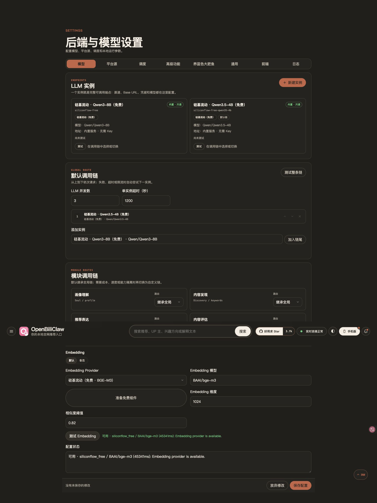

# 免费模型完整真实流程验收（2026-11-08，未发布）

本轮从 PC 首次设置页开始，两个独立数据目录分别只选 Qwen/Qwen3-8B 或 Qwen/Qwen3.5-4B，默认向量选 BAAI/bge-m3。使用本机已登录 B 站账号与实际 SiliconFlow HTTPS 请求、新版 Rust 本地候选（验签策略，无 mock、无 unsigned 模式）；用户现有应用配置/画像不变。候选没有 OS 公证，本报告不是安装包发布声明。

每组实际拉取并入库 500 条历史、455 条收藏、100 条关注，共 1,055 条；每组偏好分析分为 39 批。页面保留默认并发 3、显式超时 60 分钟（该值按阶段应用）；刷新页面不取消或重开任务。两个免费模型没有跨模型兜底。

## 本轮新增发现与修复

4B 的历史导入、39 批偏好分析、完整画像持久化成功，但初轮发现零候选，初始化以 `discovery_partial` 部分完成结束。实际 Rust 错误为 `RATE_LIMITED: local rate limit reached`，随后 Provider cooldown 令发现、聊天失败。不是上下文长度错误或模型请求超时。

签名策略的 RPM 为 300。画像完成后集中生成向量，聊天/向量工作进程共享的安装账本达到分钟窗口上限；立即失败与快速重试没有给窗口恢复时间。保留第一轮失败，不能以稍后重试结果覆盖。

修复仅对 Rust 明确的本地分钟限流拒绝等待 60 秒、同任务重试一次；等待和再次请求共用原截止时间，向 Rust 传递剩余预算。签名 cap 不变、不清空账本、不关安全校验；上游 429、凭据/配额/策略错误不使用这条等待。流式一旦交付任何 delta 则不重放；取消关闭进程，持续本地限流不在 SDK 内部两模型互备之间反复尝试。

回归先 7 failed / 3 passed；修复后新增 16 项（含取消、剩余预算、禁止跨模型重试）通过，相关五组测试 82 passed。完整 Sponsored 相关回归 331 passed、1 skipped；最终配置/API/前端相关 51 passed，另补真实语言变化拒绝快捷切换 2 passed。部分测试集重叠，不相加计总数。

## 完成结果（跨午夜至 2026-11-09）

| 项目 | Qwen3-8B | Qwen3.5-4B |
| --- | --- | --- |
| 真实导入 / 偏好批次 | 1,055 条 / 39 of 39 | 1,055 条 / 39 of 39 |
| 偏好阶段最后一次耗时采样 | 1,480 秒，约 25 分钟 | 960 秒，约 16 分钟 |
| 画像生成与持久化 | 通过 | 通过 |
| 修复后两轮真实流式聊天 / 上下文 | 通过 | 通过 |
| 三路并发聊天 | 3/3，1 条走同一持久任务的后台接续 | 3/3，全部实时流式 |
| `get_profile` 工具真实执行并总结 | 通过 | 通过 |
| 推荐卡片与重复反馈只入库一次 | 通过 | 通过 |
| 重启后画像、原模型、6 条已完成会话 | 保留；真实模型和 BGE 探测通过 | 保留；真实模型和 BGE 探测通过 |
| 重启后读取到的推荐数 | 12 | 15 |

耗时是这一次服务状态下的观察，不是性能基准或 SLA。8B 末轮两轮对话分别 50.21 / 3.55 秒；三路并发总耗时 112.99 秒。4B 两轮为 0.99 / 31.47 秒，三路并发 25.78 秒。并发任务的 admission/SSE 连接有独立 30 秒交接边界；8B 一条由现有 durable worker 接续，查询同一 turn 验证内容与持久化，未重复提交。最初验收脚本只把 SSE error 当终态，因此曾误判这类已经完成的任务；原判定保留，后续按前端实际查询持久任务的行为验证。

两组最初的阶段 4 均为 **warning / discovery_partial**，不能标成初次全流程零错误通过。修复后保留各自已生成画像，通过真实推荐刷新入口重新验证发现、评分、文案、反馈与聊天；没有再次从空目录重复全部 39 批。首次成功的画像阶段、故障阶段的恢复、独立真实限流复现与重启持久化共同构成本轮证据。

## 本地额度与探测实测

- 保持签名策略 300 RPM、不清账本，生产 Rust 池完成 **330/330** 次 BGE 业务请求；实际触发三次本地窗口等待，最长 60.75 秒。满窗口时插入真实流式聊天，等待 60.53 秒后收到 4 个 delta 并成功完成。
- 首轮 HTTP 配置探测压力测试 **318/330** 成功，另 12 次在约 15 秒返回 `EMBEDDING_BUSY`。这是配置探测外层比 180 秒业务预算短，不是 BGE 无法生成向量。
- 免费 BGE 主动探测预算改为 180 秒，PC / 插件客户端 190 秒；首次设置原已有 190 秒。原压力脚本复测 **330/330** 成功，8 次耗时超过 50 秒，最长 60.93 秒。普通后台健康轮询仍有独立 15 秒预算，可能在繁忙时短暂显示未就绪；本轮未把它改成长期阻塞请求。
- PC 真正点击“测试 Embedding”时窗口已满，页面持续显示探测中，**45.341 秒**后显示 BGE-M3 可用。截图见下方。

## 配置切换与交付边界

PC 从 4B 切到 8B 时，完整配置仅有默认链和等价语言值 `zh` → `zh-Hans` 变化，却误走完整重建、等待学习任务。对应回归先 4 failed / 4 passed；规范等价语言后，API/单独 worker 两种模式均可原地切链。实际 PC 4B → 8B → 4B 双向保存的 apply-status 均为 applied，切到 8B 的真实探测也成功。两个内置 LLM 卡片没有编辑/删除入口，免费 BGE 的模型和维度只读。

Ruff、MyPy（413 源文件）、两个修改 JS 的语法检查、隔离配置的 `config-show` 通过；未重跑约 1.4 万项全量测试。本轮浏览器操作覆盖首次设置和 PC 配置页，手机只检查 HTTP 页面可访问，插件只做共享接口/静态回归；没有测试所有来源、平台系统、付费模型、图片能力或安装包发布。

本机钥匙串初始拒绝访问，用户解锁后恢复，未跳过安全检查。重启脚本初次 30 秒等待短于应用排空时间，且一次错读 API embedding 字段层级；修正测试脚本后两组重启验证完成。只读字段、鉴权、签名策略、TLS 校验均未放松。两组测试服务已经正常停止，代理创建的浏览器页已关闭；用户原应用与主工作区未改动。

脱敏统计见 [summary.json](assets/free-full-e2e-20261108/summary.json)。原始历史、画像、Cookie、配置、会话正文及服务日志保留在本机私有测试目录，没有加入仓库。候选 Rust 的短期验签策略及公开仓修复仍需按正常流程构建、签名、合并和发布；当前安装包不包含本分支的这些新修复。

