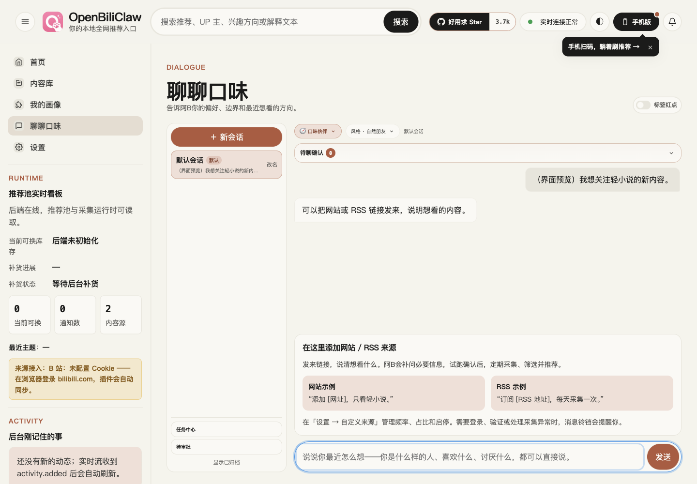
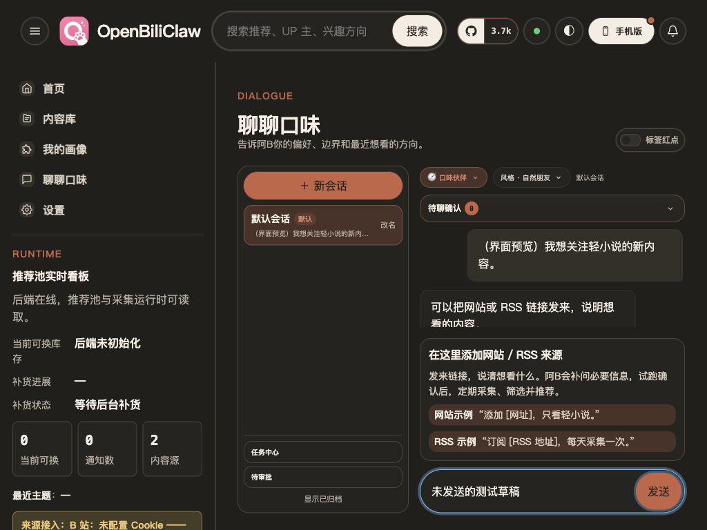

# PC「聊一聊」默认可见引导（2026-11-08，未发布）

PC Web 的来源说明改成输入框上方直接展示的说明卡，包含网站／RSS 示例与试跑确认流程；
无需展开，已有聊天记录时也可见。移动 Web、插件和原生 App 保留上一轮实现。
分支：`fix/pc-chat-source-guide-20261108`；基于上一轮工作区快照，原工作区未修改。

## 实际页面验收

使用官方 Ego Lite 0.6.2.9 的原生 Node/CDP 接口访问独立本机 FastAPI 实例的 `/web/`，
加载本分支真实 HTML、CSS、JS 与聊天接口。未使用 Playwright。
测试实例禁用生命周期后台任务，模型地址仅作 UI 占位；未发送聊天、调用模型或新增采集来源。
聊天记录为明确标注「界面预览」的已完成测试记录，用于检查有历史时的展示。

- 1440×1000：浅色／深色，默认显示说明与两个示例，输入框可见。
- 1024×768、1440×650、768×768、375×812：无横向溢出，输入框在视口内，聊天记录区至少保留 100px，未发送草稿保持不变。
- 初次实测发现 1024px 窗口的说明卡挤压聊天记录，仅剩 6px；缩短文案、紧凑示例行与矮窗口标题后，复验记录区分别为 144／129／165／187px。
- 完整页面说明保留来源管理与消息提醒位置；紧凑布局优先展示说明、两个示例及聊天区。
- Pytest 桌面异常展示与设置结构 10 项通过；Node 聊天过程与会话隔离 48 项通过；`git diff --check` 通过。

验收结束关闭本轮隔离 Ego 和后端，不修改已有 AppReview 服务、用户配置或其它工作区。
此记录验证 PC 引导展示，不代表本轮重新完成真实模型建源 E2E；尚未合入或部署到正在运行的版本。
