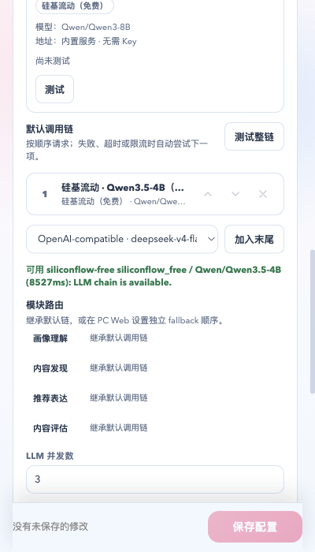

# 硅基流动免费模型真实链路复测（2026-11-12）

## 环境

- Chrome for Testing 151.0.7922.34，开发者加载完整 MV3 扩展 `knfmcbgdjlcbkeallffjnnmahoggnlog`；扩展 service worker 正常启动，不是 popup 页面 shim。
- 真实后端 `127.0.0.1:8420`，使用真实 `config.toml` 的隔离副本、真实数据库 / memory 副本；`/api/health` 返回 `profile_ready=true`。
- 免费模型走官方已签名 sponsored runtime（`sponsored-runtime-2026-11-05.1` 归档 bundle），模型 `Qwen/Qwen3.5-4B`；runtime 使用临时解锁 keychain 和独立 ledger，测后已恢复登录 keychain。
- 本地 Ollama 的 `qwen2.5:0.5b`、`qwen2.5:7b` 已停止/卸载；只保留 `nomic-embed-text`、`bge-m3` 两个 embedding 模型，未参与对话。
- 真实配置和真实数据库没有被修改；测试配置、Chrome profile、临时后端和 keychain 均已清理。

## 真实请求

| 请求 | 结果 |
| --- | --- |
| `POST /api/config/probe-service`，`kind=sponsored`，`check_embedding=false` | HTTP 200，`ok=true`，`Qwen/Qwen3.5-4B`，**4321ms** |
| 完整扩展设置页「测试整链」 | 状态从 pending 到 success：`可用 siliconflow-free siliconflow_free / Qwen/Qwen3.5-4B (8527ms): LLM chain is available.` |
| 原付费默认链（同一真实后端，未改模型） | 真实请求完成，约 **756ms**，上游返回 `429 rate limit`（保留边界） |

## 证据

截图中的默认调用链是「硅基流动 · Qwen3.5-4B（免费）」，成功文案为 8527ms；没有使用 Ollama 对话模型。

## 清理

- 停止测试后端和 Chrome for Testing；
- 删除临时 worktree、config 副本、数据库副本、runtime ledger 和 Chrome profile；
- 恢复原 login keychain，删除临时 keychain；
- `main` 保持 `340096d4`，无产品代码改动。
