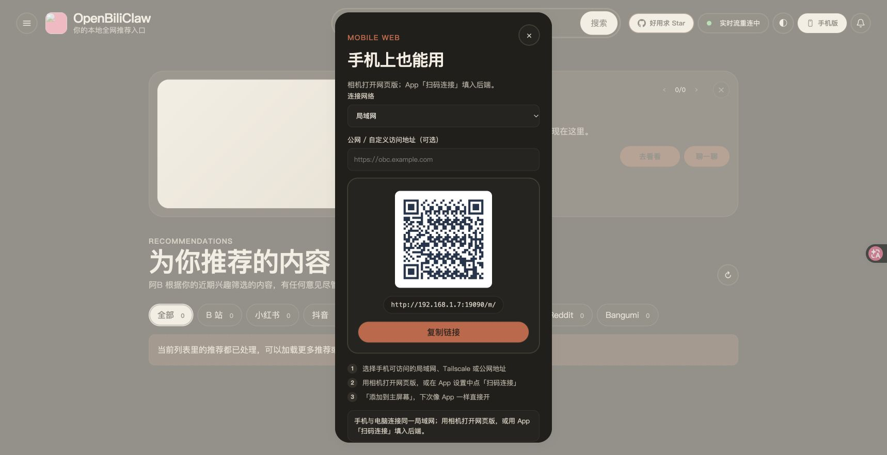
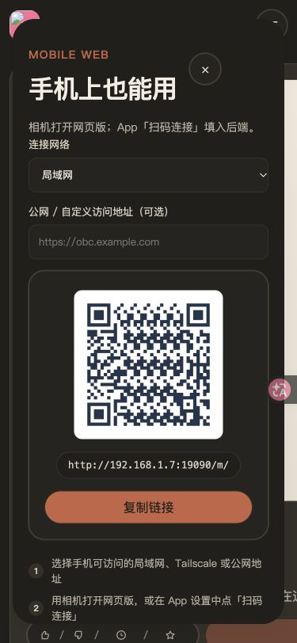
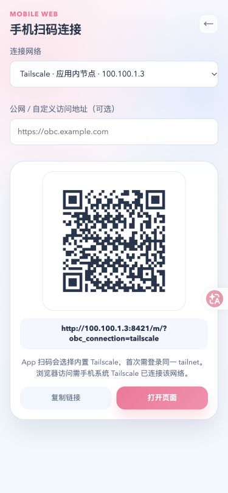

# 手机扫码连接验证（2026-10-26）

后续真实请求与设备验收见 [2026-10-27 真实环境验证](2026-10-27-mobile-connection-live.md)，不要将本页的合成浏览器服务结果当成真实网络验收。

后端分支：`codex/mobile-network-qr`；配套 App 分支位于独立 `OpenBiliClaw-mobile` 仓库，分支同名。两边均从各自主工作区的 HEAD 创建独立 worktree，未复制主工作区已有的 README / 宣传素材或 App 修改。

## 复现与修复

原始复现命令 `node --test tests/js/mobile-network-qr.test.mjs` 首次运行 2 failed：

- 桌面保存 `backendHost=127.0.0.1` 时，即使 fresh `lan_ip=192.168.1.7`，生成的仍是 `http://127.0.0.1:8420/m/`。
- 无可用 LAN 地址时仍绘制回环二维码。

修复后同一入口的行为测试通过；增加公网默认端口、代理路径、自定义 LAN 端口、空探测清旧地址与两种 Tailnet 连接的回归。新安装原本已默认 `0.0.0.0`，仅统一桌面包 / 内部启动函数的异常回退，保留显式仅本机设置。

## 自动检查

| 检查 | 结果 |
| --- | --- |
| `ruff check src/ tests/` | PASS |
| `mypy src/` | PASS，363 个源文件 |
| `openbiliclaw config-show` | PASS；日志只在本机，不提交配置内容 |
| 最终扫码 / 静态交付 / 桌面入口 Python 选择 | PASS，47 项 |
| 安装脚本 / 安装协议 / packaged entry / 桌面入口 | PASS，91 项，2 skipped |
| QR v5 / v10 | 桌面和插件矩阵均逐格等于 Python `qrcode` 的 byte-mode、L、mask=0 参考结果 |
| 共享前端行为 | PASS，12 项；包括原始两条失败场景 |
| 插件完整测试 / 类型 / 构建 | PASS，1857 项；类型与 Chrome asset preflight 通过 |
| App 单元与 widget 测试 | PASS，179 项；扫码连接 7 项通过，含首次 Tailnet 入网和失败保留旧后端 |
| App `flutter analyze` | PASS |
| Android debug / iOS simulator 编译 | PASS，最终源码分别重新构建成功 |
| 原生图片解码 | PASS，macOS 原生解码器识别后端实际生成的五张固定 PNG（v5 / v10） |

完整后端 `python -m pytest` 运行 1412.21 秒后保留为 **1 failed、3380 passed、2 skipped**，随后人工中断可选浏览器轮次，退出码 130。失败是未改动的 `tests/test_database.py::test_card_settlement_insert_or_ignore_arbitrates_across_connections`，50 线程竞争中的 `Barrier.wait(timeout=5)` 超时；同文件随后独立复跑为 **69 passed**。没有改数据库代码、测试或超时，也不把完整轮次记成全绿。

剩余基础测试按不重叠文件清单分三组，仍由标准 `python -m pytest -q -m 'not integration' <files...>` 入口执行；从 `test_desktop_web_issue_98_e2e.py` 之后继续，可选浏览器用例不计为通过。三组分别为 **2763 passed / 39 skipped / 45 deselected**、**2901 passed / 7 skipped / 110 deselected**、**2956 passed / 9 deselected**，退出码均为 0；不合并成一次完整轮次全绿的声明。新建 Python 选择的最后两条矩阵参数在分组中再次覆盖；嵌套的 `tests/youtube/test_takeout.py` 独立 15 项通过。

## 浏览器验证

使用真实 Chrome 加载仓库页面；业务接口使用 `test_desktop_web_settings_save_e2e.py` 的本地合成服务，插件 HTML 额外提供仅测试页生效的 Chrome storage stub。截图中的 IP / 域名均为测试地址，不代表实际网络连通。

1. 桌面「手机版」显示 fresh LAN `http://192.168.1.7:19090/m/`。
2. 切换应用内 Tailnet 后显示 `http://100.100.1.3:8421/m/?obc_connection=tailscale` 和 App / 系统 VPN 的区别。
3. 输入 `https://obc.example.com:9443/prefix/web/`，二维码变成保留前缀的 `/prefix/m/`。
4. 插件 popup 同样切换地址；清空服务的网络发现结果，再关 / 开弹层，旧二维码消失，复制 / 打开禁用。
5. 375×812 检查发现旧移动样式 `inset:0` 使居中抽屉缩成半屏；补 `bottom:auto` 后二维码与复制按钮完整显示，额外内容可滚动。测试后恢复浏览器原尺寸。

## 设备与发布边界

原生 App 的扫码导入 → 设置保存 → 重连 → 重启恢复由 widget 测试覆盖；取消 / 非法地址保留旧后端。追加首次 Tailnet 回归先复现“保存设置但没有连接”，再接入原有连接 / 网页登录流程；入网失败保留旧客户端设置并提示，7 项扫码 widget 用例通过。图片解码测试使用由后端 / 插件实际 JS 编码器生成的五张固定 PNG，包含 v5 / v10、LAN、系统节点、应用内节点、公网端口 / 前缀与长地址；它不请求相机权限。`mobile_scanner` 不支持 iOS 模拟器图片分析，所以真实解码测试在受支持的 macOS 原生目标运行。

相机实拍、真实手机跨局域网 / tailnet grants / 公网链路仍需设备验收，不能由合成接口、widget 或本机图片解码代替。本次是双仓库源代码功能，不代表商店、安装包或当前运行后端已经升级；需协调发布配套版本。使用步骤见[手机扫码连接](../mobile-connection.md)。
